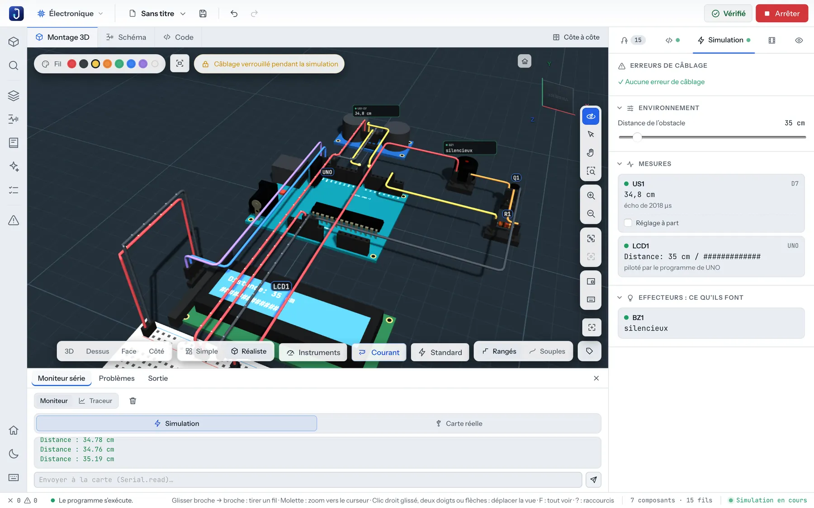

<p align="center"><picture><source media="(prefers-color-scheme: dark)" srcset="docs/brand/logo-dark.svg"></picture></p>

<p align="center"><b>Un labo complet. Sans le labo.</b><br>
<i>A full lab. Minus the lab.</i></p>

<p align="center">
  <a href="https://github.com/xelaktechsn/jollof-studio/releases/latest"><b>Télécharger</b></a> ·
  <a href="https://xelaktechsn.github.io/jollof-studio/">Site</a> ·
  <a href="https://xelaktechsn.github.io/jollof-studio/aide/">Aide en ligne</a> ·
  <a href="docs/GUIDE.md">Guide complet</a>
</p>

<p align="center"><a href="https://xelaktechsn.github.io/jollof-studio/"></a></p>

Jollof Studio est une application de bureau, gratuite et open source, pour **concevoir, simuler et vérifier** de vrais systèmes sans matériel : montages électroniques, circuits pneumatiques, logique, réseaux de bâtiment. Pensée pour les élèves, les enseignants et les apprentis ingénieurs, surtout là où un vrai labo manque. Écrite à Dakar par Mamadou Sarr (Xelaktech).

## Ce qu’on peut faire

Sept types de projet : électronique, analogique, pneumatique, électropneumatique, logique, réseau, objets connectés. Le type choisi décide des plans de travail affichés.

- **Câbler en 3D** : 156 composants et 10 cartes (Arduino Uno, Nano, Mega, ESP32, ESP32-S3, ESP32-C3, ESP8266, Raspberry Pi Pico). Sur 8 d’entre elles, le vrai programme compilé tourne sur un processeur émulé. Câblage automatique, schéma tracé en direct.
- **Programmer** : par règles (« quand… alors… »), par blocs ou en C++ Arduino ; MicroPython sur le Pico. Débogueur pas à pas, moniteur série, analyseur de bus I2C, SPI et série.
- **Vérifier** : le vérificateur essaie chaque état atteignable du montage et compare chaque composant aux valeurs limites de sa fiche. Tant qu’une erreur reste, rien ne part vers une vraie carte.
- **Pneumatique et GRAFCET** : vérins, distributeurs, GRAFCET qui produit le programme, automate Ladder, machines animées en 3D, couplées au montage électronique.
- **Logique numérique** : portes, bascules, compteurs, mémoires, tables de vérité, Karnaugh.
- **Analogique** : NE555, amplis, MOSFET, générateur et oscilloscope ; formes d’onde calculées par ngspice.
- **82 TP guidés**, vérifiés pas à pas, avec compte rendu PDF : 28 d’électronique, 20 de pneumatique, 14 de logique, 20 de réseau et d’objets connectés.
- **Passer au réel** : téléversement sur une vraie carte, moniteur série, guide de montage imprimable, export KiCad.
- En **français et en anglais**.

### Réseau de bâtiment (nouveau dans la 0.4)

Un projet réseau a un seul modèle et quatre vues : logique, plans, baies, conception.

- **Plans à l’échelle** : bâtiments, étages, murs, pièces ; import d’un plan d’architecte DXF ou DWG comme fond vectoriel, ou d’un plan scanné étalonné.
- **Cheminements** : chemins de câbles, conduits, colonnes montantes ; la longueur de chaque lien suit son tracé.
- **Baies 19 pouces** : élévation avant et arrière, U occupés, poids, puissance, chaleur, plan de brassage.
- **Fibre** : bilan optique des liaisons, accord entre module et fibre.
- **Réseau simulé** : VLAN 802.1Q, Spanning Tree, agrégats, routage entre VLAN, OSPF, DHCP, listes d’accès ; ping et traceroute.
- **Wi-Fi** : carte de couverture calculée d’après les murs, plan de canaux.
- **Dimensionnement** à partir des surfaces : prises, ports, panneaux, budget PoE, métrés de câble.
- **Testeur de certification simulé** (Cat 5e, 6, 6A) ; import des résultats d’un vrai testeur, rangés à part.
- **Livrables** : étiquettes, tableaux des câbles et du brassage, nomenclature, plan d’adressage, planches PDF.
- **Catalogue** de 79 produits de 8 fabricants, saisis d’après leurs fiches publiques.
- **Objets connectés** : un module W5500 ou une carte ESP32 en Wi-Fi rejoint le réseau du plan ; MQTT et Modbus TCP.

| Format | Import | Export |
|---|---|---|
| DXF | oui | oui |
| DWG (par un convertisseur installé) | oui | oui |
| IFC | IFC4, IFC2X3 | IFC4 |
| Visio (.vsdx) | oui | oui |
| draw.io | — | oui |
| Excel (.xlsx) | oui | oui |
| NetBox 4 | oui | oui |
| Résultats de testeur (CSV, texte, XML) | oui | — |
| PDF, SVG, CSV | — | oui |

## Limites à connaître

- La certification des liens et la couverture Wi-Fi sont **simulées** : des calculs sur le plan, à confirmer par des mesures sur site.
- Le DWG passe par un convertisseur installé sur l’ordinateur (ODA File Converter, ou dwg2dxf) ; aucun n’est livré avec l’application.
- DWG et NetBox demandent l’application de bureau ; la version navigateur ne les a pas.
- macOS n’est pas encore livré. Windows 7 et 8 ne sont pas pris en charge.
- Le vérificateur juge les états stables, pas les pointes de courant. Wi-Fi et Bluetooth des cartes passent par un réseau simulé.
- La liste complète est dans le [guide](docs/GUIDE.md#limites-connues).

## Installer

| Système | Fichier |
|---|---|
| Windows 10/11 | `Jollof-Studio-Windows-x64-setup.exe` |
| Linux | `.AppImage`, `.deb` ou `.rpm` |
| macOS | pas encore livré |

Tout est sur la [page des versions](https://github.com/xelaktechsn/jollof-studio/releases/latest). On peut aussi [essayer dans le navigateur](https://xelaktechsn.github.io/jollof-studio/app/), sans installation.

Déjà installé ? L’application propose elle-même les nouvelles versions (à partir de la 0.2.1).

## Compiler soi-même

Il faut [Node.js 20+](https://nodejs.org) et [Rust](https://rustup.rs) ([prérequis Tauri](https://tauri.app/start/prerequisites/)).

```bash
npm install
npm run tauri dev      # lancer en développement
npm test               # la suite de tests
npm run tauri build    # construire l’installateur
```

## En savoir plus

- [Aide en ligne](https://xelaktechsn.github.io/jollof-studio/aide/), avec recherche ; produite à partir du [guide complet](docs/GUIDE.md) : toutes les fonctions, raccourcis, structure du code, limites connues.
- [Ce que prouve le vérificateur](docs/PROVEN.md)
- [Architecture](docs/ARCHITECTURE.md)
- [Performances mesurées](docs/PERFORMANCE.md) et comment refaire les mesures
- [Plan de démonstration](docs/DEMO.md) : quoi montrer dans une vidéo ou en salle, et quoi ne pas promettre
- [Contribuer](CONTRIBUTING.md)

## English

Jollof Studio is a free, open-source desktop app to design, simulate and check real systems with no hardware: electronics (Arduino, ESP32 and Pico in 3D, with the real compiled program on an emulated processor), pneumatics with GRAFCET and 3D machines, digital logic, and, new in 0.4, building networks: floor plans to scale, DXF/DWG import and export (DWG through an installed converter), cable pathways with real lengths, racks, fibre budgets, simulated VLAN/STP/OSPF, computed Wi-Fi coverage, a simulated certification tester, and IFC, Visio, draw.io, Excel and NetBox exchange. 156 components, 10 boards, 82 guided labs; English and French. Windows and Linux; macOS is not shipped yet. [Download](https://github.com/xelaktechsn/jollof-studio/releases/latest) · [Website](https://xelaktechsn.github.io/jollof-studio/) · [Help](https://xelaktechsn.github.io/jollof-studio/aide/).

## Licence

© 2026 Mamadou Sarr. [AGPL-3.0](LICENSE) avec [conditions supplémentaires](NOTICE.md) ; [licence commerciale](COMMERCIAL.md) possible. Composants tiers : [THIRD_PARTY.md](THIRD_PARTY.md).
