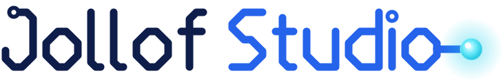

<p align="center"><picture><source media="(prefers-color-scheme: dark)" srcset="brand/logo-dark.svg"></picture></p>

# Jollof Studio — guide complet

Résumé : [README](../README.md).

Application de bureau pour monter des circuits électroniques en 3D, connecter les broches, animer le câblage et exporter des vidéos pédagogiques. Construite avec Tauri 2 (cœur en Rust) et Three.js.

Site de présentation (français et anglais) : **https://xelaktechsn.github.io/jollof-studio/** — sources dans [`site/`](../site/), publiées sur GitHub Pages par [`.github/workflows/pages.yml`](../.github/workflows/pages.yml) à chaque modification poussée sur `main`.

Télécharger l’édition gratuite : [page des versions](https://github.com/xelaktechsn/jollof-studio/releases/latest) (Windows : `Jollof-Studio-Windows-x64-setup.exe` ; Linux : `.AppImage`, `.deb`, `.rpm` ; macOS : bientôt). Les installateurs sont construits et publiés par [`.github/workflows/release.yml`](../.github/workflows/release.yml) quand une étiquette `v<version>` est poussée, ou à la main depuis l’onglet Actions.

**Mises à jour** (édition gratuite installée, à partir de la 0.2.1) : quelques secondes après l’ouverture, l’application lit `latest.json` dans la dernière version GitHub ; s’il y a plus récent, une carte en bas à droite propose « Mettre à jour » (téléchargement, vérification de la signature, projet enregistré, installation, redémarrage) ou « Plus tard ». Le menu du projet a aussi « Rechercher les mises à jour… ». Windows garde la langue choisie à l’installation ; un `.deb` ou un `.rpm` se met à jour par le même type de paquet (mot de passe demandé par `pkexec`), une AppImage se remplace elle-même. L’édition Pro n’est pas concernée.

- Code : `src/ui/update.js` (greffons `updater` et `process` de Tauri), adresse du manifeste et clé publique dans `src-tauri/tauri.conf.json` (`plugins.updater`).
- Publication : `release.yml` signe chaque installateur (`tauri signer sign`, secrets `TAURI_SIGNING_PRIVATE_KEY` et `TAURI_SIGNING_PRIVATE_KEY_PASSWORD`) puis `scripts/update-manifest.mjs` écrit `latest.json`, publié avec les installateurs. Une préversion n’est pas proposée (elle n’est pas la « dernière » version).
- Clé privée : `~/.tauri/jollof-studio.key` (et son mot de passe) sur l’ordinateur du mainteneur, à sauvegarder hors de l’ordinateur. **Perdue, plus aucune installation existante ne peut se mettre à jour** (il faudrait réinstaller à la main).
- Publier une nouvelle version : changer `version` dans `src-tauri/tauri.conf.json`, `package.json` et `src-tauri/Cargo.toml`, pousser, puis pousser l’étiquette `v<version>`.

## Fonctions

- **Accueil** : au premier lancement (et tant qu’il n’y a aucun projet à reprendre), aucun projet ni exemple n’est chargé d’avance : l’accueil s’ouvre. Ensuite, le dernier projet se rouvre directement. L’accueil propose un nouveau projet (une carte par type : Électronique, Analogique, Pneumatique, Électropneumatique, Logique), la reprise du dernier projet (sauvegarde automatique, intacte tant qu’on n’a rien choisi), l’ouverture d’un fichier, les exemples, les TP et le tutoriel. Au premier lancement, une présentation en quatre étapes passe d’abord (« Revoir la présentation » la rejoue). Menu du projet → « Accueil » y revient ; Échap le ferme sur un plan de travail vide. Code : `src/ui/home.js`.
- **Interface à la manière d’un éditeur de code** (familière à qui connaît VS Code) : une barre d’activité à gauche (bibliothèque, recherche, exemples, schéma, documentation, TP, classe, problèmes, accueil, commandes), des onglets au-dessus du plan de travail (Montage 3D, Schéma, Logique, Pneumatique selon le type du projet), un panneau du bas (Ctrl+J) avec **Problèmes** (la liste du vérificateur, ligne par ligne, plans pneumatique et logique compris : un clic va au composant, à l’élément ou à la ligne du programme) et **Sortie** (les messages d’état et le journal du téléversement, horodatés), un compteur de problèmes dans la barre d’état, et une **palette de commandes** (Ctrl+Maj+P ou F1) qui exécute toute action au clavier et ouvre un exemple, pose un composant ou lance un TP en tapant son nom. **Thème clair ou sombre** : bouton soleil / lune en bas de la barre d’activité, ou palette (« Thème clair », « Thème sombre », « Thème : suivre le système ») ; sombre par défaut, retenu d’une session à l’autre. Code : `src/ui/shell.js`, `src/ui/commands.js`, `src/ui/theme.js`.
- **Exemples de pneumatique** : un exemple qui a des électrovannes ou des capteurs de vérin s’ouvre comme un projet électropneumatique complet (carte Arduino Uno, alimentation 24 V, électrovannes, capteurs et boutons du pupitre câblés, programme écrit d’après le GRAFCET, vue partagée). Dans un projet électropneumatique, un exemple tout pneumatique s’ouvre comme un nouveau projet pneumatique. Une entrée du pupitre du GRAFCET (dcy…) et le bouton du montage du même nom ne font qu’un.
- Bibliothèque de 154 composants courants (dont l’alimentation 24 V, l’électrovanne 24 V, le capteur de position de vérin et le pressostat de l’électropneumatique), dont 16 composants standard décrits en paquet `.jpart` (SHT31, INA219, thermocouple MAX6675, débitmètre YF-S201, indice UV GUVA-S12SD, TMP36, thermistance NTC, accéléromètre ADXL335, PIR AM312, distance Sharp GP2Y0A21, force FSR 402, contact reed KY-021, lumière TEMT6000, gaz MQ-3, MQ-4 et MQ-7), et ventilateur 5 V, mini pompe à eau, moteur vibreur, capteurs de flamme, de pluie, de niveau d’eau, d’obstacle infrarouge, de ligne, à effet Hall, d’inclinaison et de vibration, LM35, BME280, BH1750, balance HX711, bouton tactile TTP223, radar RCWL-0516, qualité de l’air MQ-135, module laser et feu tricolore), classés par catégorie et filtrables par recherche (les composants que l’on crée ou importe soi-même sont rangés à part, dans « Mes composants ») : cartes (ESP32 DevKit V1, ESP32 DevKitC 38 broches, ESP32-S3, ESP32-C3 SuperMini, ESP8266 NodeMCU, Wemos D1 mini, Uno, Nano, Mega 2560, Pico), breadboards, capteurs, entrées, écrans, sorties, moteurs, passifs, alimentation, communication.
- Plan de travail sans limite : le tapis, la lumière et les ombres suivent la vue, on se déplace où l’on veut (clic droit glissé, deux doigts sur le pavé tactile, Maj + molette ou flèches du clavier) et l’on peut reculer assez pour embrasser un très grand montage. Un composant ajouté par un clic se pose au centre de la vue.
- Zoom vers le curseur : la molette (ou le pincement sur le pavé tactile) zoome vers le point visé, qui reste immobile à l’écran.
- Repère X, Y, Z en haut à droite du plan de travail, comme en CAO : un cube d’orientation (DESSUS, AVANT, DROITE, GAUCHE, ARRIÈRE) tourne avec la caméra, avec ses axes X (rouge), Y (vert), Z (bleu) et une boussole (N, E, S, O). Un clic sur une face, une arête ou un coin oriente la vue ; glisser sur le cube fait tourner la caméra ; la maison revient à la vue 3D de tout le montage.
- Repères des composants (R1, LED1, ESP32…) au-dessus de chacun, à afficher ou masquer par un bouton en bas du plan de travail. La position du curseur sur le tapis s’affiche dans la barre d’état.
- Blocs : « Encadrer » (en haut du plan de travail ou dans l’onglet Câblage), puis tracer un rectangle sur le tapis, regroupe les composants qu’il contient sous un nom (« Alimentation », « Capteurs »…). Le cadre entoure ces composants et les fils qui les relient, et suit leurs déplacements ; saisir son étiquette déplace tout le bloc. Un clic sur l’étiquette sélectionne le bloc : huit poignées blanches permettent alors de l’agrandir ou de le réduire, et les composants que le cadre couvre au relâchement le rejoignent (ceux qu’il ne couvre plus le quittent) ; Échap désélectionne. Un composant posé ou déposé sur le cadre d’un bloc le rejoint tout seul (le plus petit cadre l’emporte quand des cadres se chevauchent) ; déplacé hors du cadre de son bloc, il le quitte, sauf s’il en est le dernier composant : le cadre le suit alors. Le cadre clignote et la barre d’état le dit ; Ctrl+Z annule. Nom, couleur et composants se règlent dans l’onglet Câblage ou depuis le composant sélectionné. Les blocs apparaissent en cadres pointillés sur le schéma électrique.
- Fils rangés automatiquement : chaque fil monte de sa broche, file à angle droit au-dessus des composants et redescend. Les fils parallèles prennent des couloirs voisins (pas de 2,54 mm) plutôt que de se superposer ; deux fils qui se croisent passent à des hauteurs différentes, et un fil qui survole la broche d’un autre passe au-dessus de son fil. Calcul rapide (grille de voisinage) : seuls les fils dont le tracé change sont reconstruits ; pendant le déplacement d’un composant d’un grand montage, seuls ses fils sont recalculés ; au-delà de 250 fils, le rangement complet se fait dans un Web Worker. Le style « Souples » (arcs) reste disponible en bas du plan de travail.
- Les LED partagent quatre lampes de la scène, données aux plus brillantes : un montage de cent LED reste fluide.
- Câblage direct : glisser d'une broche à l'autre, aimantation sur la broche la plus proche, couleur automatique pour GND et l'alimentation.
- Un fil par broche, comme un vrai connecteur : une broche déjà reliée est signalée « occupée » et refuse un second fil. Pour relier plusieurs fils au même point, on passe par une breadboard.
- Rebranchement : cliquer sur un fil puis glisser une de ses extrémités vers une autre broche.
- Câblage automatique : sélectionner un composant puis « Câbler automatiquement », ou « Câbler automatiquement tout le circuit ». Le bon type de broche est choisi : alimentation à la bonne tension, ADC1 sur l’ESP32, bus I2C/SPI par défaut, port série croisé. Les broches de démarrage sont évitées (jamais un tirage au mauvais niveau sur D12 d’un ESP32 ou D3, D4, D8 d’un ESP8266), et les broches I2C restent libres pour les modules I2C. Les composants indispensables sont ajoutés, comme le ferait un électronicien d’après les fiches techniques : 220 Ω pour une LED (330 Ω pour un haut-parleur sur une carte qui débite peu), 4,7 kΩ de tirage pour la DS18B20 ; un **étage de puissance** pour ce qu’une broche ne peut pas alimenter (buzzer derrière un BC547 ; ventilateur, pompe et vibreur derrière un PN2222A avec résistance de base de 1 kΩ et diode de roue libre 1N4007, alimentés en 5 V, 22 Ω en série pour le vibreur 3 V) ; pilote L298N et pile pour un moteur réversible ; l’**adaptation de niveau** entre 5 V et 3,3 V (pont diviseur 4,7 kΩ / 10 kΩ pour un signal à sens unique comme l’ECHO du HC-SR04 ou le RX d’un HC-05, adaptateur de niveau BSS138 pour les bus I2C et SPI : écran LCD sur ESP32, BMP280 ou RC522 sur Uno) ; une diode anti-retour pour un accu sur le VSYS du Pico. Ce qui est physiquement impossible (deux entrées analogiques sur l’ESP8266, plus de broches que la carte n’en a de libres) est refusé avec une explication plutôt que câblé à moitié. Chaque composant câblé seul sur chaque carte, et des montages à plusieurs modules, passent le vérificateur sans erreur ni avertissement (`node --test src/sim/autowire.test.mjs`). Quand une breadboard est sur le plan de travail, l’alimentation et la masse passent par ses rails, et les bus partagés (I2C) ou les jonctions (résistance de tirage) par ses rangées de 5 trous. S’il en faut une et qu’il n’y en a pas, elle est ajoutée, et les fils directs déjà en place sont déplacés dessus. Les nouveaux fils sont animés, avec leur rôle en légende.
- Explication du câblage : pour le composant sélectionné, le rôle de chaque broche et où elle est reliée. Les erreurs sont signalées : broche non alimentée, masse non commune, signal 5 V sur une carte 3,3 V, broche sans ADC. Le code Arduino est donné avec les broches réellement utilisées.
- Simulation : des curseurs règlent l’environnement (température, humidité, lumière, distance, gaz, son, inclinaison…) selon les capteurs présents. Un capteur peut aussi avoir son propre réglage (« Réglage à part » sous sa mesure) : deux capteurs infrarouges à des distances différentes, un aimant devant un seul capteur à effet Hall ; ce réglage est enregistré avec le projet, et un assistant IA le règle par `set_environment` avec `part`. Chaque capteur réagit comme le vrai : plage, résolution, inertie, cadence de lecture et valeur brute de l’ADC. Les mesures s’affichent au-dessus des capteurs et sur les écrans OLED/LCD reliés, et une impulsion parcourt le fil de données. Un capteur mal câblé ne mesure rien et dit pourquoi. Les courts-circuits sont signalés.
- Programmation des cartes (onglet « Code ») :
  - **Exécution du programme** : il n’y a plus de mode à choisir. Dans l’application installée, le **vrai programme** est compilé par arduino-cli puis tourne instruction par instruction sur un ATmega328P émulé (Uno, Nano), un ATmega2560 émulé (Mega 2560 : 256 Ko de flash, six minuteries, quatre ports série, seize entrées analogiques, 4 Ko d’EEPROM ; avr8js, MIT) ou sur le RP2040 du Pico (rp2040js, cœur arduino-pico) : tout le C++ d’Arduino (classes, modèles, pointeurs, `sprintf`, registres, interruptions, EEPROM…) et toutes les bibliothèques. Un programme déjà compilé n’est pas recompilé (cache par carte et par code), les fichiers de la carte et les bibliothèques ne sont vérifiés qu’une fois par session, et une retouche du montage relance le programme après une courte pause (pas une compilation par clic). Les broches, la PWM, `tone()`, les impulsions de servo, le port série, l’ADC et l’EEPROM se raccordent au même montage, et les modules répondent comme les vraies puces sur leur bus ou leur signal (`src/emu/devices/`) : écrans LCD I2C et OLED SSD1306, BMP280, MPU6050, DHT11/22, DS18B20 (1-Wire), HC-SR04, NeoPixel, clavier, récepteur IR, RC522, nRF24L01, HC-05 et SIM800. Le **Pico** se programme au choix en C++ d’Arduino ou en **MicroPython** (le vrai MicroPython officiel sur le RP2040 émulé, avec éditeur Python, fichiers `main.py`, `lib/…`, REPL dans le moniteur série et Ctrl+C, même dans le navigateur). Le **simulateur intégré** prend le relais seulement là où le vrai programme ne peut pas tourner, et le journal de la carte dit pourquoi : carte sans processeur émulé (ESP8266), version web (pas de compilateur), arduino-cli absent (un message dit comment l’installer), débogueur pas à pas (F8, points d’arrêt), ESP32 sans son émulateur, ou dont le programme utilise le Wi-Fi ou le Bluetooth. **ESP32, ESP32-S3 et ESP32-C3** : le vrai programme tourne dans QEMU, l’émulateur d’Espressif (GPL-2.0), programme à part d’environ 15 Mo téléchargé à la première utilisation (`qemu-system-xtensa` pour l’ESP32 et la S3, `qemu-system-riscv32` pour la C3) ; Serial, broches, `digitalRead`, `analogRead`, `attachInterrupt`, PWM, `tone()` et servo par le LEDC, et **tous les modules du montage**, qui répondent par une cale ajoutée au programme à la compilation (`src/emu/esp32-shim/`, fonctions du cœur remplacées par `--wrap`) vers les mêmes modèles que l’Uno et le Pico : bus I2C (`Wire` : écrans LCD et OLED, capteurs, horloges, EEPROM, extenseurs, PCA9685…), bus SPI (`SPI` : écrans TFT, carte microSD de la bibliothèque SD de l’ESP32, RFID, nRF24L01, LoRa, MAX7219), 1-Wire (`OneWire` : DS18B20), signaux temporisés (DHT11/22, HC-SR04 avec `pulseIn` ou `micros()`, TM1637, registres à décalage, clavier, codeur, pilotes pas à pas), NeoPixel (RMT), `Serial1` et `Serial2` vers les modules série (HC-05, HC-12, GPS, SIM800) ; l’analyseur de bus voit leurs échanges. Le temps « des modules » retranche ce que l’émulation ajoute (accès aux registres lents dans QEMU, attentes de réponse), pour que les impulsions gardent leur durée. Les programmes Wi-Fi et Bluetooth restent sur le simulateur intégré, qui simule le réseau : QEMU n’émule pas la radio de l’ESP32 ; de même avec un récepteur infrarouge (IRremote échantillonne sa broche par une interruption de minuterie, qui ne se déclenche pas dans QEMU) ou un MAX485 (son modèle ne passe que par SoftwareSerial, que l’ESP32 n’a pas), et pour l’instant avec une balance HX711 (mesures en série pas encore fiables). Les bibliothèques qui lisent les registres GPIO directement (Encoder de Paul Stoffregen) ou pilotent le RMT sans le cœur Arduino (FastLED) ne voient pas le montage ; LedControl ne compile pas pour l’ESP32 (MD_MAX72XX oui). Sur l’ESP32-S3 et l’ESP32-C3, la PWM du LEDC n’est pas encore décodée, et sur la C3 le DHT ne répond pas encore. Corpus ESP32 (programmes réels dans `src/emu/corpus-esp32/`) : `JOLLOF_QEMU=… node --test src/emu/esp32-corpus.test.mjs`. Détails : `docs/ESP32-QEMU-TRIAL.md`. Corpus de programmes réels (programmes Uno et leurs bibliothèques dans `src/emu/corpus/`, programmes Mega dans `src/emu/corpus-mega/`, programmes Pico dans `src/emu/corpus-pico/`) : `node --test src/emu/corpus.test.mjs`.
  - **Règles** : sélectionnez un composant puis « Programmer », ou « + Règle ». Une règle relie une mesure à une action : « quand BTN1 est appuyé, LED1 s’allume, sinon elle s’éteint », « quand la distance est sous 20 cm, le buzzer bipe », « le potentiomètre fait varier la vitesse du moteur ». Les règles s’imbriquent : chaque branche « Alors » ou « Sinon » contient plusieurs actions et d’autres conditions (« quand le sol est sec, arroser, sauf s’il fait plus de 35 °C ») ; une seule condition sous « Sinon » devient un `else if`. Chaque règle devient du vrai code Arduino, commenté, avec les broches réellement câblées. Chaque règle se lit comme une phrase, sans rien à taper :
    - **Conditions** : « + et / ou… » ajoute une condition (« et », « ou », « sauf si ») ; une mesure se compare à un nombre, à une autre mesure ou à une variable. Le petit bouton « ⋯ » d’une condition ouvre ses options : « dès que » (une seule fois, quand elle devient vraie ; anti-rebond des boutons compris), « depuis 2 s » (vraie depuis au moins ce temps), « marge » (hystérésis : « au-dessus de 30 °C, retombe sous 28 °C »). Les sources du temps : « toutes les 2 s », « au démarrage », et l’heure d’une horloge DS3231/DS1307 (« à 07:30 »). Les événements reçus : une ligne du moniteur série (« reçoit « marche » »), un code de télécommande infrarouge, une touche de clavier, un badge RFID, un message LoRa, HC-12, Bluetooth ou RS-485, un cran d’encodeur.
    - **Actions** : chaque effecteur, écran et module de la bibliothèque a les siennes (afficher une mesure ou une variable sur un écran à la ligne voulue, envoyer une valeur par radio, ajouter une ligne au fichier de la carte SD…) ; le moniteur série écrit un texte ou une valeur, ou trace une courbe. « + autre… » ajoute « puis attendre 2 s » (la suite continue sans bloquer la carte), « changer une variable » ou « passer à une étape ». Sous une condition qui dure, compter, écrire, envoyer et changer d’étape ne se font qu’une fois, quand elle devient vraie.
    - **Variables** (« + Variable ») : un nombre entier, un nombre à virgule, un vrai/faux ou un texte de longueur fixe ; une règle le met à une valeur, l’augmente, le diminue (sans jamais déborder) ou l’inverse, le compare, l’affiche. « Gardée hors tension » l’enregistre dans l’EEPROM (au plus toutes les 5 s, et seulement si elle a changé).
    - **Séquences** (« + Séquence ») : des étapes, une seule active à la fois, comme un GRAFCET : les actions d’une étape se font en y entrant, puis une transition « après 5 s », « quand BTN1 est appuyé » (ou les deux) mène à l’étape suivante. Une règle peut tester « l’étape Rouge est active » ou faire « passer à l’étape Vert ».
    - **Code robuste** : le programme écrit par les règles n’utilise jamais `String` (pas de mémoire dynamique), garde ses textes fixes en flash (`F()`, `PSTR()`) sur AVR, utilise des types de taille fixe (`constexpr uint8_t` pour les broches, `uint32_t` pour le temps), ne bloque jamais (`millis()`, débordement après 49 jours compris ; ni `delay()` ni `pulseIn()` sans limite), lit chaque mesure une fois par tour, écarte une mesure ratée (DHT muet, DS18B20 débranchée à −127 °C, bus I2C sans réponse : la dernière bonne valeur reste, et « est en panne » devient vrai), ne réécrit un servo, une PWM, un écran ou une puce I2C que si l’ordre change, et borne chaque réglage à la génération. À la fin de `loop()`, la carte se repose une milliseconde (veille légère sur AVR) au lieu de tourner à vide. Chaque programme compile sans un avertissement (`-Wall -Wextra`) sur Uno, Nano, Mega, Pico et ESP32 (`src/prog/rules.compile.test.mjs`).
  - **États par défaut** : un effecteur reçoit un état de départ (LED éteinte, servo à 90°, relais ouvert, texte sur l’écran…), appliqué dans `setup()` et, au choix, chaque fois qu’aucune règle ne le commande dans le tour de `loop()`. Un capteur ou une entrée reçoit une valeur de départ pour la simulation (bouton appuyé, curseur à 30 %, température à 35 °C…), reprise à chaque lancement. Ils se règlent dans l’onglet Code (« États par défaut ») ou sur le composant sélectionné.
  - **Code** : le code généré se modifie librement (il n’est alors plus réécrit ; « Règles » remet les règles aux commandes), ou s’écrit entièrement à la main. Coloration, numéros de ligne, erreurs signalées pendant la frappe avec une suggestion (« vouliez-vous écrire digitalWrite ? »), Tab, Ctrl+/ pour commenter, Ctrl+Entrée pour téléverser.
  - **Exécution** : le programme est compilé dans l’application puis exécuté en temps virtuel pendant la simulation. `delay()` ne fige rien et une boucle sans fin non plus ; la ligne en cours est repérée dans l’éditeur. Les entiers suivent la carte (`int` sur 16 bits sur un Uno, 32 bits sur un ESP32), une division par zéro ou un indice hors du tableau arrête le programme et montre la ligne.
  - **Ce qui est simulé** : `pinMode`, `digitalRead/Write`, `analogRead/Write` (ADC et PWM de la carte), `millis`, `tone`, `pulseIn`, interruptions, `Serial` (moniteur série avec envoi), `String`, et les bibliothèques DHT, OneWire + DallasTemperature, Adafruit BMP280, MPU6050, SSD1306 (textes et formes), LiquidCrystal_I2C, Servo/ESP32Servo, NeoPixel, Stepper, et `ledc` sur ESP32.
  - **Effecteurs** : les LED (simples, RGB, barrette WS2812, 7 segments) s’allument selon le niveau ou la PWM, le servo tourne, le pas à pas tourne, le buzzer et le haut-parleur sonnent, les écrans affichent ce que le programme y écrit. Moteur, ventilateur, pompe et vibreur **suivent le calcul du circuit** : leur vitesse vient de la tension réellement reçue, quelle que soit la commande (pile seule, transistor, contacts du relais, pilote L298N et sa PWM) ; l’hélice, les pales, la turbine (avec son jet d’eau) et le vibreur bougent en 3D, avec inertie. Le relais a ses contacts **COM, NO, NC** : sa bobine colle quand le module est alimenté et IN tiré à la masse (broche à LOW ou fil), et COM–NO alimente vraiment la charge. Les effecteurs tirent leur courant (bobine, servo qui tourne, moteur) et le signal d’un servo se lit comme ses impulsions. Erreurs vues par le calcul : broche de carte surchargée (moteur branché directement), moteur sous trop de tension, ventilateur à l’envers, servo sous-alimenté. Les erreurs typiques sont expliquées : broche sans PWM, entrée qui flotte sans `INPUT_PULLUP`, `digitalWrite` sans `pinMode`, mauvaise adresse I2C, type de DHT différent du capteur câblé…
  - Pendant la simulation, un clic sur un bouton du montage l’enfonce.
- Schéma électrique 2D (bouton « Schéma ») : le montage redessiné sur une feuille A4 ou A3 paysage, avec cadre, repères de zones et cartouche. Symboles dans l’esprit de la norme CEI 60617 : résistance, condensateurs, diode, LED, LED RVB, bouton poussoir, potentiomètre, transistor NPN, pile, moteur, buzzer, haut-parleur ; cartes, modules et capteurs en blocs avec le nom de chaque broche (Uno : alimentation et analogiques à gauche, D0 à D13 à droite). Alimentations et masses par leurs symboles, liaisons simples en fils, les autres par étiquettes de nœud ; une breadboard n'est pas dessinée, ses rangées et ses rails deviennent les liaisons qu'ils font. Chaque symbole garde l'orientation du composant sur le tapis (au quart de tour près ; cartes et modules restent droits) ou celle choisie dans la vue Schéma (touche R, Maj+R pour le miroir) ; ses textes restent lisibles ; broche non reliée marquée d’une croix, court-circuit signalé. Une seconde feuille donne la nomenclature et la liste des connexions. « Enregistrer en PDF » écrit un PDF vectoriel (sans bibliothèque) ; « Imprimer » passe par l’impression du système.
- Pendant la simulation, le câblage est verrouillé : on ne tire, ne rebranche ni ne retire de fil (les corrections proposées par les erreurs restent possibles). Les composants se sélectionnent et se déplacent toujours.
- Erreurs de câblage pendant la simulation : une alerte apparaît et le bord du plan de travail clignote en rouge. Des ondes et une étiquette marquent la broche fautive et celle à l’autre bout, et les fils en cause rougeoient. Un court-circuit fait des étincelles, une surtension fait de la fumée. Un fil fantôme vert montre la bonne broche. Chaque erreur dit où elle est, pourquoi c’est un problème dans un vrai montage et comment corriger. Un bouton se branche dans les deux sens : vers la masse (entrée avec tirage, appuyé = LOW), vers l’alimentation avec une résistance de rappel vers la masse (appuyé = HIGH, le code généré suit), ou sans carte en interrupteur dans le circuit d’une pile ; une LED commandée par un interrupteur n’est pas en faute, et un bouton qui relierait seul le + à la masse est signalé. Corrections en un clic : « Relier à la masse » (bouton sur l’alimentation sans résistance de rappel : l’autre patte passe à GND, le code passe à `INPUT_PULLUP`), « Brancher sur 3V3 » (bouton sur 5 V avec une carte 3,3 V), « Retirer le fil » (bouton seul entre le + et le −). « Voir » amène la caméra dessus. « Recâbler », « Inverser les fils », « Relier les masses » ou « Retirer le fil » corrigent en un clic.
- Documentation : chaque carte, capteur et composant a sa fiche, avec caractéristiques, fonctionnement, brochage, utilisations, erreurs fréquentes et exemple de code. Un modèle 3D qu’on peut tourner aide à reconnaître le composant ; survoler une ligne du brochage allume la broche sur le modèle. On l’ouvre par le bouton « Documentation », le « ? » de la bibliothèque ou « Fiche » sur le composant sélectionné.
- Exemples : six montages prêts à simuler et un « Montage à corriger » plein d’erreurs volontaires. On les ouvre par le bouton « Exemples » ; les fichiers sont dans le dossier [`exemples/`](../exemples/).
- Interface : barre d’outils à icônes, inspecteur à onglets (Câblage, Simulation, Vidéo), barre d’état, historique complet pour annuler et rétablir.
- Animation du câblage, en une fois ou fil par fil, avec légendes.
- Timeline de la vidéo (bouton « Timeline » de l’onglet Vidéo) : sous le plan de travail, une piste pour la caméra, une pour les fils, une pour les légendes (et, dans l’édition Pro, une pour les notes). On glisse la tête de lecture pour voir la vidéo à un instant précis ; on déplace ou rogne un extrait à la souris (aimantation sur les autres extraits, la tête de lecture et une grille de 0,1 s ; Alt pour la couper) ou au clavier (flèches, Maj pour 1 s, Alt pour rogner). « Grouper » trace plusieurs fils ensemble. « + Légende » (touche L) et, en Pro, « + Note » (touche N, puis un clic sur le montage) ajoutent un élément à la tête de lecture et ouvrent un panneau à droite de la timeline : on y écrit le texte (et, pour une note, son titre et son type), son début et sa durée, la scène montrant le résultat en direct ; Entrée ou un clic ailleurs valide, Échap annule. Double-clic sur une légende ou une note : le même panneau. Double-clic sur la piste Caméra : la vue actuelle devient un plan à cet instant (clic droit : remplacer, coupe nette, supprimer). Ctrl + molette zoome. Tant qu’on ne la modifie pas, la timeline est automatique (« Séquence » et « Durée par fil ») et redonne exactement l’animation d’avant ; modifiée, elle est enregistrée avec le projet et chaque geste s’annule. Le modèle est dans `src/video/timeline.js` (pur, testé : `node --test src/video/timeline.test.mjs`), la piste dans `src/video/dock.js`.
- Rendu réaliste : de vraies pièces CAO sont posées sur les modèles dessinés.
  - Pièces : module ESP32-WROOM-32 et ESP-12E, carte Raspberry Pi Pico, ATmega328P en DIP-28, connecteurs USB, jack, quartz, LED 5 mm, résistances, diodes, condensateurs, TO-92, buzzer, bouton, potentiomètre, pile 9 V.
  - Les broches restent celles du modèle dessiné, donc simulation et câblage sont inchangés.
  - L’interrupteur « Simple / Réaliste » sur le plan de travail passe d’un rendu à l’autre.
- Import de ses propres cartes : un fichier STEP (.step, .stp) ou glTF (.glb, .gltf) est converti dans l’application (millimètres, axe vertical, centrage). Un assistant en trois étapes dit ce que représente le modèle :
  - **apparence d’un composant de la bibliothèque** : on clique chaque broche demandée sur le modèle ; le composant garde tout son comportement (simulation, câblage automatique, erreurs) ;
  - **carte à microcontrôleur** : on choisit la famille (ESP32, ESP32-S3, ESP32-C3, ESP8266, RP2040, ATmega328P) et on nomme les broches comme sur la carte (GPIO4, D13, GP15, A0, 3V3, GND…). Tensions, ADC, bus I2C/SPI, broches de démarrage et broches de la flash en sont déduits ;
  - **module ou capteur** : chaque broche reçoit un rôle (alimentation, masse, données, analogique, I2C, SPI, série…), deviné d’après son nom ;
  - **objet décoratif**, sans broche.

  Le résultat s’ajoute à la bibliothèque personnelle.
- Export vidéo rendu image par image, aux normes de diffusion. Chaque image est calculée à son instant exact (barre de progression, temps restant, annulation), puis encodée par la puce graphique quand le système le permet (WebCodecs : VideoToolbox, Media Foundation, VA-API) et rangée dans un MP4 par Mediabunny :
  - codecs H.264 (profil High, lu partout), HEVC/H.265 (`hvc1`, fichiers plus légers) ou AV1 (libre de droits), avec repli sur H.264 ; le niveau annoncé est le plus petit qui couvre l’image, la cadence et le débit (H.264 tableau A-1, H.265 tableau A.8, AV1 annexe A) ;
  - 720p, 1080p, 1440p, 4K UHD ; 23,976, 24, 25, 29,97, 30, 50, 59,94 ou 60 images/s, en fractions exactes (25 et 50 pour les pays à secteur 50 Hz) ;
  - couleur UIT-R BT.709 : la conversion RVB → Y′CbCr 4:2:0 est faite par un shader dans le contexte du rendu 3D (`src/video/yuv.js`), dans la plage que l’encodeur annonce, pour que l’en-tête du flux et la boîte `colr` disent vrai (mesuré : sans elle, Chromium encode en BT.601 et WebKit se déclare en plage pleine avec des valeurs en plage limitée, d’où une vidéo délavée) ;
  - débits recommandés par YouTube (qualité « Web ») ou 2,5 fois plus (« Original », pour le montage), une image clé par seconde, index en tête du fichier (lecture immédiate sur le web) ;
  - marque et légende dans la zone de sécurité titre (UER R 95 : 90 % centraux) ;
  - piste de sous-titres WebVTT (ISO/IEC 14496-30) tirée des légendes, et fichiers `.srt` / `.vtt` à part depuis la fenêtre « Vidéo prête » (YouTube, logiciels de montage) ; titre, date et langue (ISO 639-2) écrits dans le fichier.
  Format « ProRes 422 HQ » ou « DNxHR HQ » (application de bureau) : master pour le montage, par le ffmpeg livré avec l’application (version LGPL, programme à part). Chaque image est lue en RVBA sur la puce graphique et envoyée à ffmpeg, qui la convertit en BT.709 4:2:2 (10 bits en ProRes) ; son PCM 24 bits, sous-titres `mov_text`, piste de code temporel SMPTE, dans un `.mov` (`src-tauri/src/ffmpeg.rs`). Sous Linux, quand la webview ne sait pas encoder, ce même ffmpeg fait le MP4 (H.264 OpenH264, AV1 ou VP9 selon le binaire) au lieu de l’enregistrement en temps réel.
- Bande-son (onglet Vidéo, `src/audio`) :
  - musique libre : 11 morceaux de FreePD.com sous CC0 1.0 (domaine public, sans attribution obligatoire, usage commercial permis), dans `public/audio/music`, ou un fichier importé ; volume, fondus d’entrée et de sortie, en boucle sur toute la vidéo ;
  - effets synthétisés par l’application (clic, pop, tic, souffle, carillon, réussite, mise sous tension, étincelle) : un à chaque fil tracé, un quand le circuit est câblé ;
  - voix off : « Enregistrer la voix » lance un décompte, puis l’animation défile depuis la tête de lecture pendant qu’on parle (niveau du micro affiché, arrêt à la fin de l’animation ou au bouton) ; la prise est posée à cet instant. On peut aussi importer un fichier, déplacer une prise, régler son volume. Prise sans annulation d’écho ni gain automatique (ils déforment la voix), puis passe-haut 80 Hz au mixage ; la musique baisse sous la voix (12 dB par défaut, anticipé de 0,25 s, relâché en 0,6 s) ;
  - sonie selon UIT-R BS.1770-4 (`src/audio/loudness.js`, testé sur les cas de l’UER Tech 3341) : cible Web/YouTube −14 LUFS, UER R 128 −23 LUFS ou ATSC A/85 −24 LKFS, crête vraie limitée (−1 ou −2 dBTP) par un limiteur à anticipation ; mesuré par ffmpeg sur une vidéo exportée : −14,0 LUFS, −1,0 dBTP ;
  - « Animer » fait entendre la bande-son exacte de la vidéo ; elle part dans le MP4 en AAC 48 kHz (Opus si le système n’a pas d’encodeur AAC) ;
  - les prises et fichiers importés sont enregistrés dans le projet (20 Mo au plus par son).
  Dans l’application, le MP4 s’écrit au fil de l’eau dans le cache (`src-tauri/src/render.rs`) au lieu de la mémoire : une longue vidéo 4K ne fait pas tomber la fenêtre ; la fenêtre le lit par le protocole `asset:`, limité au dossier des rendus, et « Enregistrer sous » le copie. Les réglages purs (niveaux, débits, cadences, sous-titres) sont dans `src/video/encode.js` (`node --test src/video/encode.test.mjs`). Si le système ne sait pas encoder, la vidéo est enregistrée en temps réel.
- Plans de caméra : la caméra passe d’une vue enregistrée à la suivante pendant la vidéo et pendant « Animer ».
- Points de vue 3D, dessus, face, côté. Position (mm) et orientation (°) saisies au clavier pour le composant sélectionné.
- Vignettes 3D dans la bibliothèque.
- Vue « Nœuds » des connexions : broches reliées regroupées, avec un nom automatique (3,3 V, GND, D21 · I2C SDA…) qu’on peut renommer d’un double-clic.
- Projets au format `.jollof` (JSON lisible), programmes et règles compris, sauvegarde automatique de la session.

## Le vérificateur : « le Rust de l’électronique »

Ce qu’il prouve, les modèles sur lesquels repose la preuve, leur comparaison avec ngspice et la source de chaque limite : [`docs/PROVEN.md`](PROVEN.md).

Comme le compilateur Rust refuse un programme dangereux, Jollof Studio ne laisse rien partir vers le monde réel tant que le montage ou son programme ont une erreur.

- **Prouvé dans tous les états atteignables.** Le vérificateur essaie chaque combinaison : boutons relâchés ou appuyés, relais au repos ou collés, potentiomètres aux butées et au milieu, sorties des capteurs à leurs extrêmes, et chaque broche que le programme commande, à LOW comme à HIGH (ce qui borne aussi la PWM). Dans chaque état, il calcule le circuit et compare chaque composant à ses valeurs nominales, lisibles par la machine (`src/check/limits.js`) : courant des LED, des broches et des sources, puissance des résistances, tension des modules et des condensateurs, transistor, diode, pilote, relais, moteurs. Le montage est d’abord découpé en sous-montages indépendants, coupés aux nœuds dont la tension ne dépend de rien (masses, 5V et 3V3 d’une carte) : chacun est essayé dans toutes ses combinaisons, les autres au repos, et les budgets partagés (toutes les GPIO, broches 5V et 3V3) additionnent la pire contribution de chacun. La preuve couvre ainsi le produit des états pour le prix de leur somme : 6 boutons et 6 LED commandées (4 096 états) en 13 calculs et 5 ms au lieu de 194 ms, 30 boutons (plus d’un milliard d’états) en 25 ms. Un sous-montage de plus de 4 096 états est échantillonné (coins, une variable à la fois, tirage) et le rapport le dit : « vérification partielle ». Le tout tourne dans un travailleur en arrière-plan ; une réécriture en Rust n’apporterait qu’un facteur constant sur un problème exponentiel et obligerait à garder deux solveurs identiques (simulation et vérification), ce qui fragiliserait la garantie.
- **Diagnostics à la manière de rustc**, avec un code stable : `erreur[J0301]: LED1 traversée par 75 mA (30 mA au plus)`, l’emplacement (cliquable), **l’état qui déclenche la faute** (« UNO D7 = HIGH », « BTN1 appuyé »), une note, une aide, la correction en un clic quand elle existe, et « Expliquer J0301 » (ce qui est vérifié, pourquoi, comment corriger). Familles : J01 alimentation et courts-circuits, J02 signaux (le « type » de chaque broche), J03 valeurs nominales, J04 polarité, J05 moteurs, J06 programme ↔ montage, J09 conseils, J1 code.
- **Programme ↔ montage** (le « vérificateur d’emprunts ») : deux sorties sur le même nœud, entrée lue en l’air dans un état (comme une variable non initialisée), `analogWrite` sans PWM, `analogRead` sans ADC, broche commandée mais reliée à rien, composant câblé jamais utilisé, `digitalWrite` sans `pinMode`, broche inexistante. Les broches sont lues dans le texte du programme (constantes, `#define`, `A0`, `LED_BUILTIN`, énumérations, bibliothèques) ; une broche calculée rend la vérification prudente (toute broche reliée peut être une sortie).
- **Code** : les erreurs du compilateur ont leur code (J1101 nom non déclaré, J1002 « ; » manquant…), leur aide sur une ligne à part et la partie fautive soulignée dans l’éditeur.
- **Pastille** à côté de « Simuler » (✓ Vérifié, ✕ N erreurs, ! avertissements), relancée après chaque changement, sans jamais figer l’interface ; **F7** ouvre le rapport.
- **Bloqué tant qu’une erreur reste** : téléversement sur une carte réelle, guide de montage, envoi d’une copie (espace classe ; l’envoi automatique à l’échéance passe toujours). La simulation, elle, tourne et montre les fautes : c’est en voyant fumer qu’on apprend. Le schéma imprimé porte le tampon « VÉRIFIÉ » ou « NON VÉRIFIÉ ».
- **`#[allow]`** : un avertissement voulu (un buzzer de 25 mA sur une broche) peut être accepté, avec sa raison, enregistrée dans le projet et affichée dans le rapport. Une erreur ne s’accepte jamais.
- **En ligne de commande**, comme `cargo check` : `node src/check/cli.mjs mon-projet.jollof` (ajoutez `--en` pour l’anglais) affiche le rapport et sort avec le code 1 s’il reste une erreur.
- **Fiches techniques respectées** : consommation de chaque module sur son alimentation (MQ-2 : 150 mA de chauffage, WS2812 : 400 mA, RC522 : 26 mA…), comptée dans le budget des broches 5V et 3V3 ; tension maximale d’une broche (VCC + 0,5 V sur un ATmega328P, 3,6 V sur ESP32, ESP8266 et RP2040) ; courant par broche propre à chaque carte ; transistor (courant, puissance dissipée), LM7805 sans radiateur (puissance), plage de VIN / VSYS ; adresses I2C en double ; broches de démarrage tirées au mauvais niveau ; sortie ECHO du HC-SR04 dans chaque état ; niveaux logiques à travers un pont diviseur (son rapport est calculé) ou un adaptateur de niveau (chaque côté à sa tension).
- La garantie vaut **dans le modèle de Jollof** : calcul en courant continu (PWM moyennée, impulsions bornées par l’état haut), valeurs nominales des composants, servo et moteurs au pire ; elle est rappelée au bas du rapport. Chaque fiche de composant liste ses « Limites vérifiées ».

## Éditions gratuite et Pro

Le même code donne deux applications. **L’édition Pro n’ajoute que l’espace classe et le mode Enseignement** ; tout le reste (simulation, vérificateur, programmation, téléversement sur une vraie carte, guide de montage, TP, assistants IA…) est dans l’édition gratuite, qui ne montre aucun bouton ni menu de l’édition Pro. Les outils Pro vivent dans un **dépôt privé à part**, `jollof-studio-pro`, cloné à côté de celui-ci (`../jollof-studio-pro`, ou le chemin donné par la variable `JOLLOF_PRO_DIR`). `src/main.js` les charge par `import('virtual:jollof-pro')`, que `vite.config.js` résout vers ce dépôt en mode « pro » et vers un module vide sinon ; le code Pro importe le code public par l’alias `@jollof/…`. La construction gratuite ne contient donc pas une ligne de code Pro, et le dépôt public se construit sans lui. L’espace classe (`src/school`, public) n’est chargé qu’en mode « pro » (`import()` dans une condition fausse à la compilation de l’édition gratuite).

| Commande | Résultat |
|---|---|
| `npm run tauri dev` · `npm run tauri:build:free` | Édition gratuite (« Jollof Studio », `sn.jollof.studio`) |
| `npm run tauri:dev:pro` · `npm run tauri:build:pro` | Édition Pro (« Jollof Studio Pro », `sn.jollof.studio.pro`), installable à côté de la gratuite |
| `npm run dev` · `npm run dev:pro` | Interface seule dans un navigateur, gratuite ou Pro |

L’édition est fixée par `.env` (`VITE_EDITION=free`) et `.env.pro` (`VITE_EDITION=pro`) ; la configuration Tauri de l’édition Pro est `src-tauri/tauri.pro.conf.json`. Un projet garde les données des modules Pro (notes…) même ouvert et enregistré avec l’édition gratuite.

Modules de l’édition Pro :

- **Enseignement** : notes numérotées posées sur un composant (elles le suivent) ou sur le tapis, de type information, astuce ou attention ; présentation pas à pas en plein écran (flèches, espace, Échap), la caméra allant sur chaque note ; les notes apparaissent dans les vidéos exportées.
- **Évaluation** (onglet du panneau Enseigner) : l’enseignant monte la solution et l’enregistre comme référence (titre, consigne) ; « Retirer tous les fils » prépare le projet à donner aux élèves. « Vérifier le montage » compare le câblage de l’élève aux liaisons attendues (peu importe le trou de breadboard ou la broche GND utilisés), liste les liaisons manquantes, les raccords en trop et les erreurs de câblage, et donne une note.
- **Espace classe** : outils de l’enseignant (classes, comptes élèves, devoirs, correction, carnet de notes) et pages des élèves, voir « Espace classe » plus bas.

Un module reçoit de l’application une interface (`moduleApi` dans `src/main.js`) : scène, caméra, composants, choix d’un point de la scène, crochet d’image, panneau à la place de l’inspecteur, bouton de barre d’outils, données enregistrées avec le projet. Un nouveau module s’ajoute dans le dépôt privé (`src/`) et s’installe dans son `src/index.js`.

## Laboratoire sans laboratoire

- **Importer un projet Wokwi** (bouton d’import de la barre d’outils) : `diagram.json` et `sketch.ino`, ou le `.zip` téléchargé ; composants, broches et programme repris, breadboards remplacées par des fils (« un fil par broche »), compte rendu de ce qui ne se traduit pas.
- **Guide de montage** (fenêtre Schéma) : un PDF à imprimer avec le matériel (quantités, repères, cases à cocher), les précautions, les blocs, le câblage pas à pas (un fil par ligne : couleur, broches de départ et d’arrivée, rôle, bloc), puis le schéma.
- **Carte réelle** (onglet Code) : le programme est compilé et téléversé par USB sur une vraie carte (Uno, Nano, Mega 2560, ESP32, ESP32 38 broches, ESP32-S3, ESP32-C3 SuperMini, NodeMCU, Wemos D1 mini, Pico) avec [arduino-cli](https://arduino.github.io/arduino-cli/latest/installation/), à installer sur l’ordinateur. « Préparer » installe le support de la carte et les bibliothèques incluses par le programme (connexion Internet nécessaire la première fois). Les **ESP32** (DevKit, 38 broches, S3, C3) sont téléversés par la bibliothèque d’[espflash](https://github.com/esp-rs/espflash) intégrée à l’application : ni esptool ni Python, progression affichée, zones déjà identiques sautées (un deuxième envoi va bien plus vite), refus clair si la puce branchée n’est pas celle du modèle choisi. « Détecter la puce » lit la puce branchée (nom, révision, flash, adresse MAC) et choisit le modèle de carte. Un paquet esp32 ancien, sans image complète, repasse par l’outil de la carte. Application installée seulement.
- **Exporter vers KiCad** (fenêtre Schéma, bouton « KiCad ») : schéma `.kicad_sch` et netlist `.net` dans un `.zip`, pour dessiner le circuit imprimé.
- **Moniteur série d’une vraie carte** (onglet Code, Moniteur série, « Carte réelle ») : la carte branchée en USB est reconnue d’elle-même (Arduino, puces CH340 et CP210x, ESP32, Pico) et choisie dès qu’on la branche ; le débit est celui de `Serial.begin()` du programme. Texte reçu en direct (UTF-8), envoi avec la fin de ligne voulue, traceur des valeurs, bouton « Redémarrer » (comme le bouton RESET). Débranchée, la carte se reconnecte seule quand elle revient ; un texte illisible (mauvais débit) propose en un clic le débit du programme ; port occupé, droits refusés (Linux : groupe dialout), câble qui ne fait que charger ou pilote manquant : chaque cas est expliqué. Un seul logiciel tient le port à la fois : le moniteur, la carte réelle Firmata et le téléversement se le passent sans conflit. Dans l’application ; dans un navigateur, Chrome ou Edge (Web Serial). Après un téléversement réussi, le moniteur de la carte réelle s’ouvre et s’y connecte tout seul ; la première fois avec un modèle de carte, son support et ses bibliothèques s’installent d’eux-mêmes ; les erreurs de téléversement courantes sont expliquées (carte qui ne répond pas, Nano compatible à l’ancien bootloader, bouton BOOT de l’ESP32, port occupé).
- **Carte réelle** (onglet Simulation, « Carte réelle (Firmata) ») : une vraie carte branchée en USB avec StandardFirmata recopie les sorties de la carte simulée et renvoie ses vraies entrées, valeur simulée et valeur mesurée côte à côte.
- **Lab analogique** : NE555, LM358, IRLZ44N, bobine, générateur de fonctions et oscilloscope à deux voies sur n’importe quel nœud ; les formes d’onde rapides sont calculées par ngspice (WebAssembly) sur une fenêtre de temps ; multimètre en alternatif (valeur efficace) ; 10 TP analogiques.
- **Logique numérique** (sélecteur « Électronique | Logique » de la barre d’application) : un plan de travail 2D pour les circuits logiques, enregistré avec le projet. Bibliothèque de 51 éléments : entrées (interrupteur, bouton-poussoir, horloge de 0,1 à 50 Hz, niveau constant, interrupteurs DIP, entrée numérique, clavier hexadécimal), sorties (LED, sonde, afficheur 7 segments, afficheur hexadécimal, afficheur de valeur décimal/signé/hexa/binaire, bargraphe, buzzer sonore), portes (OUI, NON, ET, OU, NON-ET, NON-OU, OU exclusif, NON-OU exclusif jusqu’à 8 entrées, tampon 3 états), bascules (verrous RS et D, bascules D, JK, T, RS synchrone, front montant ou descendant, entrées asynchrones PR/CLR), blocs combinatoires (multiplexeur, démultiplexeur, décodeur, encodeur de priorité, décodeur 7 segments), arithmétique (demi-additionneur, additionneur complet et n bits, soustracteur, multiplieur, comparateur, UAL à 8 opérations), séquentiels (compteur modulo n avec chargement parallèle et sens par U/D, registre à décalage dans les deux sens avec chargement parallèle, registre), mémoires (ROM programmable, RAM), câblage (nœuds, étiquettes de liaison, séparateur de bus, résistance de tirage au 1 ou au 0), textes. **Bus** : les composants qui manipulent des nombres peuvent avoir des broches de bus ; un fil de bus est épais et porte sa largeur, le séparateur le redonne bit par bit, deux largeurs différentes ne se relient pas. **Blocs** : un montage devient un bloc réutilisable (« Faire un bloc avec la sélection » ou « Nouveau bloc ») ; ses entrées et sorties nommées sont ses broches, il se pose comme une porte, peut contenir d’autres blocs, s’ouvre d’un double-clic (fil d’Ariane, Échap pour revenir) et est enregistré avec le projet. Symboles ANSI (formes) ou CEI (« & », « ≥1 », « =1 »). Simulation toujours active, au niveau des portes, par événements à retard unitaire (une bascule lit D avant le front : registres à décalage et compteurs asynchrones justes) ; niveaux 0, 1, X (inconnu ou conflit) et Z (non piloté) en couleurs sur les fils ; entrées en l’air, conflits entre sorties et oscillations signalés. Onglets **Circuit** (propriétés, fiche, table de la porte), **Table** (table de vérité des entrées et sorties nommées, ligne en cours surlignée, équations simplifiées par Quine-McCluskey ou canoniques, tableau de Karnaugh avec ses regroupements, export CSV) et **Chronogramme** (horloges lancées avec ▶, avance d’un front avec « Pas »). Huit exemples (demi-additionneur, verrou RS, compteur 0 à 9, afficheur 7 segments, chenillard, multiplexeur, additionneur 4 bits en blocs avec bus, message en ROM). Code : `src/logic/`.
- **Type de projet** : « Nouveau projet » demande ce que l’on construit, **Électronique** (carte, capteurs, programme), **Analogique** (sans carte ni programme : passifs, transistors, NE555, ampli-op, oscilloscope ; la bibliothèque ne montre que ce qui sert), **Pneumatique** (air comprimé seul), **Électropneumatique** (une carte commande une machine pneumatique) ou **Logique**. Le type dit quels plans de travail le projet montre : un seul, sauf l’électropneumatique, seul à réunir le montage et le circuit pneumatique (sélecteur Électronique | Pneumatique, vue partagée). Un projet pneumatique ne montre ni ne simule rien côté électronique ; le montage n’échange avec le circuit (bobines, capteurs) que dans un projet électropneumatique. Le bouton du type, à gauche de la barre, permet d’en changer (confirmation si du contenu serait caché) ; le type s’élargit de lui-même quand on pose un composant d’un autre plan (une carte dans un projet pneumatique le rend électropneumatique). Il est enregistré avec le projet ; un projet plus ancien le reçoit d’après son contenu. **Un seul verdict** : le vérificateur (« Vérifié », F7) réunit le montage, le programme, le circuit pneumatique, le GRAFCET et les repères qui relient les deux côtés (codes J07xx, expliqués comme les autres).
- **Supervision MA-ISA** (onglet « Supervision » de l’inspecteur, application installée) : un gardien qui observe le circuit pendant la simulation, à chaque pas, en temps simulé, sans rien y changer ; le calcul est fait par la caisse Rust publiée `maisa-core`, utilisée telle quelle. Pensée pour être prise en main sans connaître la théorie : « Ajouter une surveillance » pose trois questions, **quoi** (un vérin, une électrovanne, un capteur, une tension, montrés comme des objets du circuit, chaque broche avec ce qui y est câblé), **quel problème** (« il ne sort pas quand on le commande », « ce qu’il commande ne réagit pas », « la tension s’écarte de sa valeur normale », « elle dépasse une valeur à ne jamais franchir »…, valeurs proposées d’après le circuit) puis **vérifier** (la règle en une phrase et le temps de réaction calculé) ; « Me proposer » en crée d’après le montage ; chaque surveillance s’écrit comme une phrase, **plage** (« UNO 5V doit rester entre 4,75 et 5,25 V », limite immédiate facultative) ou **réponse** (« quand Y1 devient actif, le vérin 1A doit atteindre 0,5 en moins de 1,2 s »), et ses réglages MA-ISA sont calculés à partir de deux exigences (quel écart signaler, en combien de temps ; quel écart bref ignorer) par les fonctions de conception de `maisa-core`, qui disent aussi quand c’est impossible ; les réglages bruts restent sous « Avancé ». État en clair avec sa couleur et son icône, bannière « que faire maintenant » avec le bon bouton, niveau d’anomalie de chaque surveillance (barre et courbe, seuils d’alerte et critique), verrou de sécurité enregistré avec le projet, reprise guidée en trois étapes (confirmer l’état sûr, vérifier la reprise, réarmer), historique daté. Pannes simulées en mots simples (capteur muet, mesure figée, actionneur bloqué, décalage ou dérive, parasites), qui ne touchent que ce que voit la supervision. **Démonstration guidée** (projet du vérin électropneumatique : un cycle normal, une panne, la mise en sécurité, la reprise) et page « Comment ça marche ? ». Démonstration pédagogique, pas un système de sécurité certifié.
- **Pneumatique et électropneumatique** (projets de type Pneumatique ou Électropneumatique) : un plan de travail 2D aux symboles inspirés de la norme ISO 1219 (dessinés pour Jollof Studio) : source d’air comprimé (6 bar), unité de conditionnement, distributeurs 3/2 (normalement fermé ou ouvert), 5/2 (monostable ou bistable) et 5/3 (centre fermé, à l’échappement ou sous pression, recentré par ses ressorts) commandés par bouton poussoir, électroaimant ou pilotage pneumatique, vérins simple et double effet, **temporisateur pneumatique** (3/2 normalement fermé ou ouvert : il bascule quand son pilotage 12 est resté sous pression pendant le retard réglé, et revient au repos dès qu’il retombe ; pendant la simulation, un cadran au-dessus du symbole se remplit et donne le temps écoulé), réducteur de débit unidirectionnel, sélecteur de circuit (OU), clapet de double pression (ET), manomètre, pressostat ; tuyaux tirés d’orifice en orifice (numéros ISO 1, 2, 3, 4, 5, 12, 14). Deux modèles de simulation, au choix du circuit. **Tout ou rien** : positions des distributeurs (un bistable garde la sienne), orifices sous pression, à l’échappement ou fermés (l’air enfermé reste), vitesse d’un vérin fixée par sa durée de course et ralentie par le réducteur de débit le plus fermé du chemin. **Physique** : pression de chaque volume (orifices reliés, tuyaux, chambres des vérins ; air isotherme), débit de chaque passage selon la norme ISO 6358 (conductance sonique, débit bloqué), force de chaque piston (pression × section, section annulaire côté tige) contre la charge, le ressort, les frottements et la masse mobile ; le manomètre lit la pression, le pressostat se ferme à son seuil, l’onglet affiche position, vitesse, pression des chambres et force (testé : 25 mm sous 6 bar → 294,5 N, bloqué par 330 N). Dans les deux, une fuite est signalée pour un orifice laissé ouvert sous pression. **Couplage avec le montage électronique**, dans la même simulation : une électrovanne 24 V (repère Y1…), alimentée par un bloc 24 V et commandée par un transistor (câblage automatique avec diode de roue libre, vérifié par le vérificateur), fait basculer le distributeur qui porte son repère ; les capteurs de position de vérin (contacts ILS, repères B1, B2…) se ferment en fin de course et les pressostats (S1…) à leur seuil ; le programme les lit comme des boutons. Les assistants IA dessinent et règlent le circuit pneumatique (`pneumatic_get`, `pneumatic_add`, `pneumatic_connect`, `pneumatic_set`, `pneumatic_press`), ajoutent au montage et câblent d’un coup les électrovannes et capteurs que nomment ses repères (`pneumatic_link_bench`), tirent le programme de la carte du GRAFCET (`grafcet_program`) et lisent son état pendant la simulation ; `get_project` donne chaque liaison (repère, composant, broche de la carte) et `check_circuit` y ajoute les problèmes du plan pneumatique. Règles et blocs les connaissent (« quand B2 détecte le piston, Y1 est coupée »). **Vue partagée** (bouton « Vue partagée » à côté du sélecteur) : le montage à gauche (3D ou schéma) et le circuit pneumatique à droite, avec son GRAFCET et sa vue 3D, séparés par une poignée qui partage la place ; au-dessus du circuit, la **chaîne de commande** : une pastille par repère (Y1, B1, B2…) avec la broche de la carte qui la commande ou la lit (D2 par le transistor Q1…) et son état en direct, l’étape active du GRAFCET et les derniers mouvements ; un clic sur une pastille sélectionne le composant du montage et l’élément du plan. Elle s’ouvre d’elle-même au lancement de la simulation d’un projet électropneumatique et rend la disposition d’avant à l’arrêt (fermée par ×, elle ne s’ouvre plus seule) ; Ctrl+Z annule dans le plan sur lequel on vient de cliquer. Sans elle, une vignette du circuit pneumatique reste visible sur le banc 3D. L’onglet « Pneumatique » de l’inspecteur règle l’élément choisi, montre les liaisons avec le montage (bobines et capteurs trouvés ou absents, état en direct ; « Ajouter au montage et câbler » pose et câble ceux qui manquent) et vérifie le circuit (source absente, orifice 1 non raccordé, repère inconnu ou en double). Les distributeurs, réducteurs et cellules logiques portent un repère sur le schéma (1V1, 1S1…). **Cycles séquentiels** : distributeurs 3/2 **à galet** (fins de course a0, a1, b0, b1 actionnés par la came de la tige d’un vérin, marquée sur la tige), relevé des courses pendant la simulation (« Cycle observé » : A+ B+ A− B−) et **diagramme des phases** dans l’onglet Pneumatique. **GRAFCET** (norme IEC 60848, bouton « GRAFCET » du plan) : la partie commande, écrite dans un panneau à côté du circuit (étapes, actions continues ou conditionnelles « 1Y1 si p » et actions mémorisées à l’activation « 1Y1:=1 », réceptivités avec ET/OU/NON, variables d’étape X3, temporisations « 3s/X2 », fronts « ↑dcy » ; compteurs « C:=C+1 » comparés dans les réceptivités « C>=3 » ; divergences en OU, branches parallèles avec divergence et convergence en ET entre deux traits doubles, macro-étapes M5 dont l’expansion E … S est dessinée sous le GRAFCET, étapes encapsulantes dont l’encapsulation évolue tant qu’elles sont actives ; plusieurs GRAFCET partiels nommés et leurs ordres de forçage « F/GPN:{0} », « {} », « {*} », « {INIT} », par exemple un GRAFCET de sécurité qui fige la production pendant un arrêt d’urgence) ; il commande les électroaimants comme un automate (franchissement simultané, recherche de stabilité), lit les capteurs des vérins, les boutons de son **pupitre** (poussoirs ou interrupteurs) et ceux du montage ; pendant la simulation, jetons des étapes actives, actions émises et réceptivités vraies s’allument. Sous chaque transition temporisée, un **chronomètre** rappelle le retard et l’étape suivie (« 5 s après X2 ») ; pendant la simulation, sa barre se remplit et le temps écoulé s’affiche. Une **palette** au pied du panneau accompagne la saisie : dans une réceptivité, les boutons du pupitre, les capteurs du circuit, les opérateurs (ET, OU, NON, fronts, parenthèses), un formulaire de temporisation (durée, étape suivie) et la lecture en clair de ce qui est écrit (« a0 ET 2 s après l’activation de X3 ») ; dans les actions, les électrovannes du circuit et les actions mémorisées. **Automate programmable** (bouton « Automate » du plan, `src/plc/`) : la partie commande écrite en **Ladder** (langage à contacts, norme IEC 61131-3) et exécutée par cycles comme un vrai automate, lecture des entrées, calcul des réseaux de haut en bas, écriture des sorties. Réseaux de contacts (ouvert, fermé au repos, fronts P et N, comparaison), bobines (bobine, inversée, S, R), temporisations TON, TOF, TP, compteurs CTU, CTD, dérivations (OU) ; chaque élément porte son nom et son adresse d’automate (%I0.0, %Q0.0, %M0, %TM0, %C0), la table des variables donne nom, adresse, nature et état. Les contacts lisent le pupitre de l’automate, les capteurs du plan (a0, B1, S1), les boutons et capteurs du montage, les étapes du GRAFCET (X3) et le bit INIT (premier cycle) ; les bobines écrivent les électrovannes (Y1, qui font basculer les distributeurs) et des mémoires (M1). **Compilé comme un vrai langage** : nom inconnu (avec le nom proche proposé), entrée écrite par une bobine, temporisation sans durée, deux temporisations du même nom, double bobine (seule la dernière écriture compte), S sans R, réseau qui ne commande rien ; un programme en erreur ne tourne pas, le réseau fautif est marqué, et le vérificateur du projet reprend ces fautes (J0705 erreur, J0706 avertissement). Pendant la simulation, le courant allume les éléments, les temporisations montrent leur temps écoulé, les compteurs leur valeur. Bouton « d’après le GRAFCET » : le GRAFCET du plan traduit en Ladder comme on l’enseigne (un bit par étape, un réseau par transition avec S et R, une TON par temporisation, un contact P par front, un réseau par action, INIT pour les étapes initiales ; macro-étapes, encapsulations, GRAFCET partiels, forçages et compteurs refusés avec la raison) ; le GRAFCET passe alors en observation et l’automate commande. Test d’équivalence : la porte de TER donne les mêmes mouvements aux mêmes instants en GRAFCET et en Ladder traduit (`node --test src/plc/ladder.test.mjs`). Exemples « Automate : vérin commandé en Ladder », « porte de TER traduite » et les trois machines ; TP pn15 (premier programme), pn16 (magasin et transfert : GRAFCET puis Ladder), pn17 (embouteillage : mémoires S/R), pn18 (barrière : TON et sécurité), et le tutoriel pn19 (construire sa machine 3D : circuit dessiné pendant la construction, composants liés au vérin, à la sortie KM1 et au signal pe, Ladder, export ; contrôle `scene` qui vérifie les composants posés et leurs liaisons). Les assistants IA lisent et écrivent le programme (`plc_get`, `plc_set`, `plc_from_grafcet`). **Machine 3D** (bouton « 3D » du plan, chargée à la première ouverture : rien de plus au démarrage) : la machine animée par la simulation, sans rien à éditer ; on la tourne (glisser), la déplace (clic droit) et zoome (molette), et sa fenêtre se déplace par son en-tête et se redimensionne par son coin (place gardée ; double-clic sur l’en-tête : place d’origine). Dix scènes : vérins du circuit, porte de TER, **porte de bus du BRT** (poignée de secours), **presse de marquage** (pupitre bimanuel), **poste de serrage et de perçage**, **pantographe** d’un train électrique sous sa caténaire, **convoyeur de tri** (cellule photoélectrique, poussoir, bacs), et trois **machines à procédé simulé** (`src/pneu/process.js`) : **magasin et transfert** (magasin à gravité, poussoir, bras et ventouse ; capteurs mag « pièce dans le magasin » et pp « pièce en position de prise » ; bourrage si l’on pousse sur une pièce qui attend), **embouteillage** (tapis, butée, bec sous la cuve de jus de bissap ; capteurs pb « bouteille sous le bec » et niv « niveau atteint » ; bouteilles toutes les 8 s ou au bouton ; jus renversé si le bec coule à vide ; pleines et mal remplies comptées), **barrière de parking** (voie, ligne d’arrêt et boucle de détection veh, lisse levée par le vérin, zone de sécurité pass, lecteur de badge, feu ; voitures au bouton, qui attendent, passent, et « Choc ! » si la lisse descend sur l’une d’elles). Le procédé de ces machines (pièces, bouteilles, voitures) avance dans le pas de simulation, avec le circuit, que la vue 3D soit ouverte ou non, et ses capteurs se lisent dans le GRAFCET, l’automate et le montage exactement comme les fins de course ; le vérificateur des TP les simule de même, sans aucun hasard. Un **bandeau** en haut de la vue montre les capteurs de la machine (allumés quand ils voient), ses compteurs (magasin, transférées, pleines, passées…) et son alarme ; le bouton « Recentrer la vue » rend la caméra de départ. **Machine construite (jumeau numérique)** (`src/twin/`, scène « Machine construite (jumeau 3D) » de la liste, puis bouton « Construire » de la fenêtre) : on assemble sa propre machine à partir de composants et on la lie aux éléments réels du projet. Palette par famille : structure (bâti, bloc), transport (convoyeur à bande), actionneurs (poussoir, butée escamotable, chariot, bras tournant, ventouse, outil), capteurs (cellule photoélectrique, détecteur de proximité, qui peut ne voir que les pièces pleines ou usinées : capteur de niveau, contrôle), pièces (source, bac qui compte, bec de remplissage), pupitre (bouton, voyant), décor (étiquette, modèle glTF importé). L’**atelier** garde le plan pneumatique à gauche (on y dessine le circuit pendant que la machine se construit ; une poignée partage la place) et met la machine à droite ; l’inspecteur de la pièce choisie vit dans l’onglet Pneumatique du panneau de droite, toujours visible. Dans la vue : barre d’outils (déplacer, tourner, taille, aimantation ; dupliquer, supprimer ; grille, zones, menu Vue : recentrer, dessus, face, côté ; menu Fichier : modèles de départ, import glTF, AutomationML, exports ; Propriétés ; Terminer), palette avec recherche et tuiles par famille (réductible en icônes), ligne d’aide en bas. Un clic sur une tuile **arme la pose** : un fantôme suit le pointeur et se pose sur ce qu’on vise (bâti, convoyeur, sol), clic pour poser, Maj + clic pour en poser plusieurs, Échap pour annuler ; le manipulateur (TransformControls de Three.js) déplace (W), tourne autour de la verticale (E) ou redimensionne (R), avec aimantation de 1 à 25 cm ; double-clic sur une pièce centre la vue (F) ; l’inspecteur règle nom, position en mètres, rotation, taille, réglages et **liaisons** : un mobile suit le vérin du circuit choisi (course × position de la tige, angle × position pour le bras), un convoyeur, un voyant, une ventouse ou un bec obéissent à une sortie (action du GRAFCET, bobine de l’automate, électrovanne du montage), un capteur produit un signal nommé (identificateur IEC 61131-3) que le GRAFCET, l’automate et le montage lisent comme une fin de course, un bouton appuie sur l’entrée du même nom ; un composant peut être attaché à un mobile (parent : la ventouse sur le chariot). La vérification de la scène (vérin non lié, signal en double ou déjà pris par le circuit, entrée inconnue, convoyeur sans sortie) s’affiche sous l’inspecteur. Le moteur (`src/twin/engine.js`, sans interface ni hasard, sous-pas de 25 ms) avance dans le pas de simulation commun, que la vue soit ouverte ou non : convoyeurs qui emportent, poussoirs qui poussent ou arrêtent, pièces qui tombent du bout d’un tapis dans un bac ou au sol (comptées « tombées »), ventouse qui saisit et lâche, outil qui marque, bec qui remplit ou coule à vide, sources à période ou au bouton, bacs qui comptent avec un critère (pleine, usinée, vide) ; le bandeau montre les signaux et les compteurs, et le vérificateur du projet admet les bobines qui commandent un convoyeur ou un voyant. Conventions des outils de mise en service virtuelle : unités SI (m, s, °), repère direct Y vers le haut, sol en y = 0. **Échanges aux formats internationaux** : import d’un modèle glTF 2.0 (ISO/IEC 12113 ; .glb ou .gltf, 1,5 Mo au plus, gardé dans le projet) comme décor à l’échelle, export de la machine en glTF 2.0, export et relecture en **AutomationML** (IEC 62714-1, CAEX 3.0, édition 2.10, `src/twin/aml.js`) : un InternalElement par composant, imbriqués selon leurs parents, d’une bibliothèque d’unités système Jollof Studio, attribut Frame normalisé (x, y, z, rx, ry, rz), réglages avec leurs unités, signaux en SignalInterface (nom de variable, sens, BOOL), vérins du circuit exportés et liés par InternalLink, géométrie référencée par un ExternalDataConnector vers le glTF. Modèles de départ : scène vide, convoyeur et éjecteur, prise et dépose ; exemple « Machine construite : convoyeur et éjecteur » (un Ladder qui trie les colis, bouton Éjecter). Les assistants IA lisent et écrivent la machine (`machine_get`, `machine_set`, scène entière ou modèle). Chaque modification est annulable (Ctrl+Z) ; tests `node --test src/twin/engine.test.mjs` (moteur, exemple trié par son Ladder, aller-retour AutomationML). Leurs boutons (à maintenir, à bascule ou d’action : une voiture, une bouteille, remplir) agissent sur une entrée du GRAFCET ou de l’automate, un bouton de distributeur ou un bouton du montage du même nom. « Vérins du circuit » : chaque vérin monté sur une plaque de pupitre de formation, tige qui sort et rentre, capteurs de fin de course allumés, raccords colorés selon la pression des chambres. « Porte de TER » : une porte de voiture voyageurs à deux vantaux, un seul vérin dans le caisson au-dessus de la baie (capot transparent) qui pousse un vantail pendant qu’une courroie sur deux poulies entraîne l’autre en sens inverse, capteurs, électroaimant du distributeur, tuyaux sous pression, voyant de porte, quai et bande d’éveil ; le bouton vert du vantail s’appuie à la souris (il actionne l’entrée du GRAFCET, le bouton du distributeur ou le bouton du montage du même nom), un voyageur apparaît dans la baie quand l’obstacle est signalé. L’exemple « Porte de TER » et les TP de porte (pn05 avec la carte Arduino, pn08 en GRAFCET) l’ouvrent d’eux-mêmes. Bouton « Programme Arduino » : le GRAFCET devient le programme de la carte du montage (une variable par étape, transitions, puis sorties ; il compile tel quel) et le GRAFCET passe en observation. Les assistants IA le lisent et l’écrivent (`grafcet_get`, `grafcet_set`). **Exemples** (bouton « Exemples » ou pied de la bibliothèque pneumatique) : commande directe d’un vérin simple effet, commande indirecte d’un double effet, sécurité deux mains (ET), deux postes de commande (OU), réglage de vitesse, arrêt en cours de course (5/3), cycle A+ B+ A− B− tout pneumatique (galets), cycle A+ B+ B− A− en cascade (deux groupes), le même commandé par GRAFCET, puis avec une macro-étape, trois vérins en branches parallèles avec action mémorisée, arrêt d’urgence par forçage et compteur de cycles, marche automatique par étape encapsulante, porte de TER (temporisation, réouverture sur obstacle), les trois machines à procédé (magasin et transfert : GRAFCET traduit en Ladder ; embouteillage au capteur de niveau et barrière de parking : Ladder avec mémoires et temporisation), force et pression (modèle physique) ; chacun remplace le circuit pneumatique (Ctrl+Z pour revenir), et le projet complet « Vérin électropneumatique » (`exemples/08-verin-electropneumatique.jollof`) ajoute la carte. **TP** : onglet « Pneumatique » de la bibliothèque de TP (bouton « TP de pneumatique » du pied de la bibliothèque), voir plus bas.
- **Automate programmable (Ladder)** (bouton « Automate » du plan pneumatique) : le langage à contacts de la norme IEC 61131-3 (contacts, fronts, bobines, S/R, TON/TOF/TP, CTU/CTD, comparaisons, dérivations), exécuté par cycles comme un vrai automate, avec pupitre, table des variables et adresses (%I0.0, %Q0.0, %M0). Deux ponts vers le vrai matériel, dans l’application installée :
  - **Export PLCopen XML** (bouton « Exporter ») : le programme devient un POU en LD au format PLCopen TC6 2.01 (validé par le schéma officiel), à importer dans CODESYS, OpenPLC Editor ou Beremiz : adresses IEC (%IX0.0, %QX0.0, %MX0.0), blocs TON, CTU…, une comparaison calculée dans une variable `_CMPn` juste avant son réseau, `INIT` initialisé à TRUE puis remis à FALSE. Un nom qui n’est pas un identifiant IEC (1Y1) est renommé (`_1Y1`), et le message le dit. Un programme en erreur ne s’exporte pas.
  - **Serveur Modbus TCP** (bouton « Modbus ») : une IHM, un SCADA ou un autre automate lisent l’automate simulé et appuient sur son pupitre. Entrées TOR 0… = %I ; bobines 0… = %Q, 100… = boutons du pupitre (seules adresses inscriptibles), 200… = %M ; registres d’entrée 0… = temps écoulé des temporisations (dixièmes de seconde), 100… = compteurs, 200 = numéro du cycle, 201 = programme en erreur. Le panneau affiche ce plan avec les valeurs en direct. Arrêté par défaut ; port 5020 par défaut (502 demande des droits d’administrateur sous macOS et Linux) ; sur 127.0.0.1, sauf si l’on coche « Réseau local » (Modbus n’a pas de mot de passe : tout appareil du réseau peut alors lire et appuyer). Code : `src/plc/modbus.js`, `src-tauri/src/modbus.rs`.

Jollof Studio sert d'abord de **salle de TP d'électronique quand il n'y a pas de matériel** : on câble, on programme, on simule et on mesure comme sur une paillasse.

- **Travaux pratiques guidés** (bouton « TP ») : une bibliothèque de TP en trois onglets, **Électronique** (28 TP), **Pneumatique** (15 TP, chacun avec sa **machine en 3D** ; un **tutoriel pas à pas** « mon premier projet électropneumatique » qui part de zéro ; cinq TP électropneumatiques tirés du transport et de l’industrie : **pantographe du TER** (levé par l’air, rabaissé par ses ressorts : sécurité positive, pressostat d’autorisation, montée ralentie), **porte de bus du BRT** avec ouverture de secours (vanne manuelle qui vide le vérin, départ autorisé sur preuve), **presse de marquage à commande bimanuelle** (deux appuis à moins de 0,5 s, principe de la norme EN ISO 13851, F = p × S), **tri de colis** par poussoir de convoyeur (front montant, cadence), **poste de serrage et de perçage** piloté par une carte depuis un GRAFCET (bistable ou monostable selon ce qui doit se passer sans courant) ; puis vérin simple effet, commande indirecte, sécurité deux mains, force et pression avec le modèle physique, porte automatique électropneumatique commandée par une carte, cycle A+ B+ A− B− à galets et signal bloquant, GRAFCET d’un cycle A+ B+ B− A−, porte de TER avec temporisation et réouverture, GRAFCET à branches parallèles, actions mémorisées et macro-étape ; tuyaux vérifiés, vérins observés, cycle relevé et comparé au cycle attendu, boutons à maintenir proposés dans l’étape) et **Logique** (14 TP : portes de base, OU exclusif, tout en NON-ET, vote majoritaire, additionneurs, multiplexeur, afficheur 7 segments, bascule RS, bascule D, compteurs, registre à décalage, feu tricolore), avec filtre par niveau (collège, lycée, formation professionnelle), recherche et TP à reprendre. Un TP de logique ouvre le plan de travail logique et vérifie la table de vérité du circuit (lignes fausses montrées), une suite d’actions (impulsions d’horloge, niveaux attendus), les éléments utilisés (« seulement des NON-ET »), une équation tapée par l’élève (toute forme équivalente, ou une forme imposée : somme de produits, nombre de termes) ou une table de vérité remplie à la main ; son compte-rendu PDF contient le circuit logique. Chaque TP part d'un montage posé (non câblé), guide étape par étape et **vérifie automatiquement** : câblage (liaisons attendues, une résistance peut se poser dans les deux sens, une carte a plusieurs GND), programme (il compile et contient ce qui est demandé), comportement observé pendant la simulation (« appuyez sur le bouton : la LED doit s'allumer »), mesures au multimètre comparées au calcul du circuit, questions. Progression gardée sur l'ordinateur, **compte-rendu en PDF** (élève, étapes validées, réponses, mesures, schéma). Hors ligne, sans compte. Édition Pro : « Envoyer ce TP à une classe » en fait un devoir corrigé automatiquement. Les TP sont des fichiers JSON (`src/lab/tp/`, `src/lab/pneu/`, `src/lab/logic/`), vérifiés par `node src/lab/validate.mjs` (les étapes d’observation des TP de pneumatique sont simulées sur la solution). **À retenir** : les étapes qui portent une notion l’affichent dans un encadré « À retenir » (après la réponse quand l’étape pose une question), et un TP terminé résume « Ce qu’il faut retenir », repris dans le compte-rendu (champs `keep` et `takeaways`). Les solutions des TP avec carte sont rejouées dans l’application réelle (câblage, programme, observation) avant publication. **Tutoriels** (champ `tutorial` d’un TP, en tête de leur onglet) : une carte de l’étape en cours reste posée sur le plan de travail, le bouton « Montrer » entoure ce sur quoi cliquer (sélecteur, élément de la bibliothèque, bouton), et chaque étape se valide toute seule puis passe à la suivante : composants du montage par type et repère, montage câblé sans erreur, éléments et réglages du plan pneumatique, tuyaux désignés par type d’élément, GRAFCET qui commande et lit les bons repères, programme, état de l’interface (simulation lancée, vue partagée). Série **TER et BRT de Dakar**, en tête de chaque onglet : TP inspirés du Train Express Régional et du Bus Rapid Transit (feu prioritaire du bus, passage à niveau, fermeture des portes, portillon de validation RFID, afficheur voyageurs, batterie d’un bus électrique, compteur de voyageurs ; en logique, sécurité des portes et signal de canton) ; une série se déclare par le champ `series` d’un TP.
- **« Quelle carte choisir ? »** (Documentation, ou lien en tête de la catégorie Cartes) : microcontrôleur ou ordinateur monocarte, tableau comparatif des cartes simulées (tension logique, tolérance 5 V, broches, entrées analogiques, Wi-Fi, usages, prix indicatifs en FCFA), la règle 5 V / 3,3 V, par où commencer, pour aller plus loin. Données techniques lues dans les profils des cartes (`src/library/boardguide.js`). TP associé : « Choisir la bonne carte : Uno ou ESP32 ? » (mesure 5 V contre 3,3 V au multimètre, choix de cartes pour des projets). Autres TP de lycée : « Charge et décharge d'un condensateur » (constante de temps lue sur le traceur série) et « Le transistor, un interrupteur commandé » (Ib, Ic, Vce au multimètre).
- **Arduino Mega 2560 et Wemos D1 mini** : le Mega se programme comme l’Uno (logique 5 V, `int` de 16 bits) avec ses 54 broches, A0 à A15, l’I2C sur D20/D21, le SPI sur D50 à D53, quatre ports série (un module série est câblé sur Serial1, D18/D19) et 4 Ko d’EEPROM ; le D1 mini est un ESP8266 aux mêmes noms D0 à D8 que le NodeMCU (Wi-Fi, une seule entrée analogique), alimenté par sa broche 5V (6 V au plus). Câblage automatique, vérificateur, règles, blocs, simulation, téléversement et reconnaissance USB (Mega) les prennent en charge ; le vrai programme compilé tourne sur l’ATmega2560 émulé (minuteries 0 à 5 et leurs 15 sorties PWM, Serial1 à Serial3, A8 à A15, interruptions INT0 à INT7 et changements d’état, programmes de plus de 128 Ko) ; un module série câblé sur Serial1 à Serial3 répond au vrai programme comme sur Serial.
- **ESP32-S3, ESP32-C3 et ESP32 à 38 broches** : chaque puce a sa famille de code, avec les constantes du cœur arduino-esp32 (S3 : A0 à A19 = GPIO 1 à 20, tactile T1 à T14, LED RVB en LED_BUILTIN, Serial1 sur 15/16 ; C3 SuperMini : A0 à A5, LED sur GPIO 8, moniteur série par l’USB natif), le Wi-Fi et l’ESP-NOW, ESP32Servo, mais ni Bluetooth classique (BluetoothSerial) ni DAC sur la S3 et la C3, que le compilateur signale. Broches de démarrage, USB natif et PSRAM octale (S3) écartées par le câblage automatique ; limites de courant d’après les fiches d’Espressif (1500 mA au total pour la S3, 1000 mA pour la C3). L’ESP32 DevKitC / NodeMCU-32S (broches IO0, IO2…) se programme comme la DevKit V1, mode « Fidèle » compris. Téléversement : `esp32doit-devkit-v1` (DevKit V1, qui définit LED_BUILTIN), `nodemcu-32s`, `esp32s3`, `nologo_esp32c3_super_mini`.
- **Capteurs à bibliothèque** : BME280 (Adafruit BME280 : température, humidité, pression ; adresse 0x76/0x77), BH1750 (bibliothèque de Christopher Laws : lux, adresse 0x23/0x5C, et sa particularité : begin() reprend 0x23 par défaut) et balance HX711 (bibliothèque de Bogdan Necula : tare, set_scale, get_units, 10 mesures par seconde, lectures qui attendent la mesure suivante) sont simulés dans l’interpréteur et, registre par registre ou signal par signal, dans le mode « Fidèle » (vraies bibliothèques compilées, tests `src/emu/devices/sensors.test.mjs`). Le code généré par les règles et les blocs les lit sans bloquer `loop()` ; les bibliothèques s’installent toutes seules au téléversement. Ses propres capteurs simples (sortie analogique sur une courbe, sortie tout-ou-rien sur un seuil) se créent sans code avec « Créer un composant » ou un paquet `.jpart`.
- **Assistants IA** (bouton « IA », application de bureau) : un assistant (Claude Desktop, Claude Code, Cursor, VS Code, Windsurf, LM Studio…) pilote Jollof Studio directement par le protocole MCP, sans copier-coller : lire le montage, poser, déplacer et retirer des composants, câbler (automatiquement ou broche à broche), vérifier, écrire des règles ou du code Arduino (compilé tout de suite, erreurs rendues avec leur ligne), simuler, régler l’environnement, lire les mesures et le moniteur série, créer un composant (paquet `.jpart` déclaratif, validé, rangé dans « Mes composants » ; un composant standard ne peut pas être écrasé), voir la scène. Chaque action passe par les fonctions de l’interface : elle s’annule avec Ctrl+Z et apparaît dans le journal du panneau.
  - Mise en route : cocher « Autoriser les assistants IA », puis « Relier » en face de l’assistant voulu (détecté sur l’ordinateur). Jollof Studio écrit lui-même sa configuration : l’assistant lancera `jollof-studio --mcp`, un relais qui ouvre l’application au besoin. Ensuite, il suffit de lui parler.
  - Sécurité : pont désactivé par défaut ; écoute sur 127.0.0.1 seulement ; clé de 256 bits, rangée dans `ai-bridge.json` (dossier de données, lisible par l’utilisateur seul) et lue par le relais : elle n’est jamais écrite dans la configuration d’un autre logiciel ; en-têtes `Host` et `Origin` vérifiés (une page web ne peut pas piloter l’application) ; la première connexion d’un assistant demande l’accord de l’utilisateur, retenu ensuite (une seule demande même s’il ouvre plusieurs connexions, une ligne par assistant dans le panneau, accès retirable à tout moment), et seules les requêtes d’une session acceptée passent ; chaque relais envoie un battement toutes les 45 s : un assistant quitté disparaît de la liste, et après un redémarrage de l’application ses relais se reconnectent seuls, sans nouvelle demande ; remplacer le projet (nouveau projet, exemple) est toujours confirmé dans l’application ; « Couper tous les accès » change la clé et ferme les sessions. Configuration des assistants : seule l’entrée `jollof-studio` est écrite, copie de sauvegarde (`.jollof-backup`) avant la première modification, écriture atomique, fichier JSON avec commentaires laissé intact.
  - Code : `src/ai/tools.js` (outils), `src/ai/mcp.js` (protocole et sessions, tests `src/ai/mcp.test.mjs`), `src/ai/panel.js` (panneau), `src-tauri/src/ai.rs` (pont HTTP, sessions, relais stdio, configuration des assistants ; tests `cargo test`).
- **Banc de mesure** (bouton « Instruments ») : un **oscilloscope** à 4 voies (chaque front des sorties arrive avec son heure exacte, même à haute fréquence ; base de temps de 1 ms à 1 s par division ; fréquence, rapport cyclique, PWM et tension mesurés ; image figée) et un **multimètre** (tension entre deux points, courant dans un composant), calculés par un solveur de circuit en continu (`src/sim/dc.js` : résistances, LED, diodes, boutons, potentiomètres, piles, broches de la carte).
- **Courant animé** (bouton « Courant », en bas du plan de travail) : pendant la simulation, des points suivent le courant réel dans chaque fil (sens conventionnel, du + vers le −), plus vite quand il est fort, colorés selon la tension (gris 0 V, vert 3,3 V, jaune 5 V, rouge 9 V et plus). Au survol, un composant affiche sa tension et son courant (puissance pour une résistance ; Ic, Ib, Vce et état pour un transistor), un fil sa tension et son courant. Courants des fils : `src/sim/flow.js` ; dessin : `src/sim/flowfx.js` (un seul objet, 180 points au plus en mode léger).
- **Vue « Schéma » en direct** (en haut à gauche du plan de travail : « 3D | Schéma », touche S) : le même montage redessiné en schéma électrique (symboles CEI, mêmes repères que le schéma imprimé), où l'on voit le courant pendant la simulation. Fils colorés selon leur tension ; points qui avancent dans le sens conventionnel, à travers les composants (résistance, LED, transistor : courant de base et de collecteur), plus vite quand le courant est fort ; LED qui s'allument ; intensité écrite sous chaque composant et tension de chaque nœud (bouton « Valeurs »). Les symboles suivent l'état des composants : bouton appuyé = contact fermé (le courant le traverse), curseur du potentiomètre à sa vraie place (le courant le suit), relais collé = contact fermé, ondes sonores du buzzer ou du haut-parleur qui sonne, flèche du sens de rotation du moteur, palonnier du servo animé à son angle (et l'angle écrit), rotor du moteur, pales du ventilateur et turbine de la pompe qui tournent à la vitesse calculée, vibreur qui tremble, repère du pas à pas, contacts COM/NO/NC du relais ; les parties actives sont en orange (le schéma imprimé garde les symboles au repos). On y appuie sur les boutons (clic maintenu) et on tourne les potentiomètres (molette) ; survol = tension et courant ; **on y édite** le montage : clic sur un symbole = le sélectionner (panneau de gauche), le glisser = le déplacer (il suit en 3D, les autres restent en place), R = le faire pivoter d'un quart de tour (Maj+R : miroir ; les fils sont retracés, annulable par Ctrl+Z, enregistré avec le projet et repris par le schéma PDF), Suppr = le supprimer ; un composant de la bibliothèque se pose sur le schéma par un clic ou un glisser-déposer. **On y câble** : glisser d'une broche à une autre (bout, patte ou nom écrit dans le bloc ; ou cliquer l'une puis l'autre ; Échap annule ; relâcher sur un fil relie à son nœud) ajoute le vrai fil au montage, visible en 3D et annulable par Ctrl+Z. Une broche n'ayant qu'un fil, comme en vrai, une broche déjà câblée passe la main à un point libre du même nœud (autre GND de la carte, sinon le trou de breadboard libre le plus proche) ; s'il n'y en a pas, une rangée libre de breadboard devient le point de raccord (breadboard posée au besoin), l'ancien fil y est rebranché, le tout en une seule étape d'annulation ; relâcher sur le symbole de masse ou l'étiquette d'une alimentation relie à ce nœud. Clic droit ou Suppr sur une broche la débranche, sur un fil le retire ; erreurs de câblage entourées en rouge ; double-clic sur un composant = le retrouver en 3D. Les nœuds de plus de deux broches (bus I2C partagé, pont diviseur) y sont reliés par de vrais fils avec jonctions, tracés par un plus court chemin sur la grille de 2,54 mm (le schéma imprimé garde ses étiquettes de nœud). La scène 3D, cachée, n'est plus dessinée : la vue Schéma coûte moins que la 3D. `src/schematic/live.js` (vue), `src/schematic/flows.js` (courant de chaque fil du schéma, calculable sous Node), disposition partagée avec le schéma PDF (`layoutSchematic` dans `src/schematic/sheet.js`).
- **Condensateurs, transistors, Zener, MOSFET** : le solveur avance dans le temps (BDF2, méthode de Gear d’ordre 2, pas de 2 ms au plus : 0,1 % d’écart sur une charge RC de 50 ms) ; charge et décharge RC, transistors NPN et PNP bloqués / actifs / saturés, Zener qui régule en inverse, MOSFET canal N et canal P. `analogRead` lit la tension calculée à travers les composants (pont diviseur, condensateur) ; une LED alimentée par une pile, le 5 V ou un transistor s'allume d'après son courant réel. Un condensateur chimique monté à l'envers est signalé (avec « Inverser »).
- **Valeur réglable des passifs** : chaque résistance, condensateur et bobine a sa valeur, tapée dans le panneau de sélection (« 4k7 », « 100n », « 10 mH »…) ou choisie dans les séries normalisées (E24). Les anneaux de couleur de la résistance suivent, le schéma l’écrit, le solveur et le vérificateur s’en servent ; un condensateur a aussi sa tension de service (le vérificateur la contrôle). Un projet Wokwi garde la valeur exacte de ses résistances. Code : `src/sim/passives.js`.
- **Moteurs** : un moteur à courant continu a sa force contre-électromotrice, proportionnelle à sa vitesse : au démarrage il tire V/R (la pointe réelle), puis le courant retombe quand il prend de la vitesse. Le vérificateur le juge calé, le cas le plus défavorable. Les contacts d’un relais suivent la bobine à l’image suivante (≈ 16 ms, le temps de basculement d’un vrai relais).
- **Analyseur de bus** (onglet du banc de mesure) : chaque échange I2C, SPI et série de chaque carte, décodé octet par octet comme par un analyseur logique : adresse, lecture ou écriture, octets, ACK ou NACK, module qui répond ; une adresse I2C sans réponse ressort en rouge, un filtre « NACK seulement » trouve le capteur muet. Vrai programme comme simulateur intégré ; export CSV. Code : `src/sim/buslog.js`, `src/sim/busview.js`.
- **Débogueur** (onglet Code) : clic dans la marge = point d'arrêt ; Continuer/Pause (F8), pas à pas principal (F10), entrer (F11), sortir (Maj+F11), point d'arrêt à la ligne du curseur (F9). En pause : ligne surlignée, horloge virtuelle figée (les autres cartes continuent), variables locales et globales (les valeurs changées depuis la dernière pause sont signalées). Compilé en mode débogage seulement quand c'est utile : aucun coût sinon.
- **Traceur série** (onglet Code, « Moniteur | Traceur ») : les nombres écrits avec `Serial.print` / `println` (format du traceur de l'Arduino IDE : `a:1 b:2`, séparés par espaces, virgules ou tabulations) deviennent des courbes (8 au plus), fenêtre de 2 à 30 s, échelle automatique, curseur, « Figer », export CSV.
- **Trois façons de programmer** (onglet Code, sous sa barre) : **Règles** (« quand… alors… », le code s’écrit tout seul), **Blocs** et **Code** (C++ écrit soi-même), chacune expliquée d’une phrase ; ce qui serait perdu en changeant est d’abord confirmé. Passer des règles aux blocs **convertit les règles en blocs** : chaque règle devient un « si / sinon si / sinon » avec sa phrase en commentaire, « fait varier » devient « convertir (limiter la mesure) », un état par défaut devient un bloc de « au démarrage » (ou une variable « … commandé » quand il revient dès qu’aucune règle ne commande), les écrans et le moniteur série gardent leurs mesures ; le programme obtenu fait la même chose (vérifié par des tests qui exécutent les deux). « Repartir des règles » refait les blocs ; « Programmer » sur un composant ajoute la règle en blocs. En mode Règles, le programme qu’elles écrivent se lit en **code** ou en **blocs** (aperçu en lecture seule, refait à chaque règle modifiée). Passer à « Blocs » ou à « Code » propose de partir des règles ou de zéro : **blocs vides**, ou **programme vide** où bibliothèques, broches et objets des composants sont déjà déclarés (les règles restent enregistrées).
- **Code généré sobre** (règles et blocs) : chaque capteur lent est lu à son rythme sans bloquer la boucle (DHT22 toutes les 2 s, BMP280 toutes les 0,5 s, HC-SR04 toutes les 60 ms, MPU6050 toutes les 20 ms) ; une mesure utilisée plusieurs fois dans un même événement n’est lue qu’une fois ; l’image d’un OLED part au plus 5 à 10 fois par seconde (un envoi prend ~25 ms) au lieu d’à chaque ligne ; un LCD ne réécrit que les lignes qui changent ; les textes s’impriment morceau par morceau, sans String à construire, et restent en mémoire flash avec F() sur les cartes AVR ; un réglage calculé est nommé (`m1_consigne`) plutôt qu’imbriqué.
- **Blocs de code** : programmation par blocs à assembler pour les plus jeunes (Blockly, chargé seulement quand on ouvre ce mode). Événements, broches, temps, conditions, boucles, maths, texte, variables, moniteur série, son, servo et **blocs du montage** (« LED1 s'allume », « température de DHT1 »…). Le code Arduino généré, lisible, s'affiche en lecture seule dessous ; le bloc en cours d'exécution est surligné ; « Convertir en code » passe au code modifiable (les blocs restent enregistrés).

## Réseau informatique et objets connectés

Deux types de projet de plus : **Réseau** (le plan réseau seul) et **Objets connectés** (le montage électronique et le plan réseau). Le réseau simulé est le même partout, `src/net/lan.js` : plan réseau, programmes de l’interpréteur, vrais programmes sur l’émulateur, vérificateur, TP et outils de l’IA s’en servent tous. Il se recalcule quand le plan change (pas d’horloge) ; le plan est enregistré dans `settings.modules.net` du projet (`src/net/clean.js` le relit).

- **Plan réseau** : une bibliothèque d’équipements (PC, ordinateur portable, imprimante réseau, serveur NAS 10 Gb/s, switch 8 ports, switch PoE 8 ports, box, point d’accès Wi-Fi, prise murale RJ45, panneau de brassage 12 ports, caméra IP, téléphone IP, Serveur MQTT, Automate Modbus TCP), des câbles de catégorie 5e, 6 ou 6A avec leur longueur, et des outils : Sélection, Câble, Testeur, Ping. L’inspecteur (onglet Réseau) règle chaque équipement : adresse fixe ou DHCP, masque, passerelle, appareil ancien (100 Mb/s sans Auto-MDIX), serveur DHCP et plage de la box, nom et mot de passe du Wi-Fi, classe PoE, alimentation par PoE ou bloc secteur. Le navigateur d’un PC ouvre les pages des équipements et des objets connectés.
- **Sertissage** : chaque bout d’un câble est une fiche RJ45 à huit places ; l’atelier de sertissage (`src/net/ui/crimp.js`) range les conducteurs (vue de dessus, broche 1 à gauche), rappelle T568A et T568B, puis sertit. Câble droit : la même norme aux deux bouts ; croisé : T568A d’un côté, T568B de l’autre. Un conducteur absent, deux conducteurs mélangés ou un court-circuit de sertissage deviennent des défauts réels du câble.
- **Testeur de câble** (`src/net/ui/tester.js`) : boîtier maître et bouchon distant, voyants 1 à 8, à travers prises et panneau ; mode **Continuité** (broche à broche : une paire séparée passe) et mode **Qualification** (carte de câblage, paires torsadées vérifiées : ouvert, court-circuit, paire inversée, paires croisées, paire séparée). Analyse dans `src/net/cable.js`.
- **Liens et vitesses** : chaque port négocie avec celui d’en face, à travers les prises passives : 10/100 Mb/s sur les paires 1-2 et 3-6, 1 Gb/s sur les quatre paires, 10 Gb/s sur du Cat 6A (Cat 6 : 55 m au plus). **Auto-MDIX** : une carte récente croise elle-même émission et réception, un câble droit suffit partout ; deux appareils anciens du même genre veulent un câble croisé. Au-delà de 100 m le lien perd des trames et retombe à 100 Mb/s ; au-delà de 150 m il n’y a plus de lien.
- **PoE** : le switch PoE (d’après le TP-Link TL-SG1008P : 4 ports, 30 W par port, budget 64 W) réserve la puissance de la classe de chaque appareil (classe 1 : 4 W, classe 3 : 15,4 W, classe 4 : 30 W) ; budget dépassé, le dernier port servi reste éteint. Caméra, téléphone et point d’accès ont les classes de leurs fiches.
- **Adresses, DHCP, ping** : adresse fixe ou DHCP (la box répond par de vrais messages DHCP : DISCOVER, OFFER, REQUEST, ACK), adresse 169.254 quand aucun serveur ne répond, passerelle et traduction d’adresses de la box, noms des équipements (PC1, ETH1…) résolus par la box. Le ping donne la raison d’un échec : pas de lien, pas d’adresse, personne à cette adresse, passerelle hors du réseau, boucle entre switchs…
- **Services** : la box et l’imprimante ont une page web d’état, le **Serveur MQTT** est un broker MQTT 3.1.1 (port 1883 : sujets reçus, clients et abonnements dans son panneau, publication à la main), l’**Automate Modbus TCP** est un serveur Modbus (port 502 : bobines, entrées, registres ; ceux du programme Ladder du projet s’il y en a un).
- **Objets connectés** : un module **W5500** ou **ENC28J60** câblé en SPI sur le montage devient un appareil du plan réseau (nom ETH1…, à câbler au switch) ; une carte **ESP32** (ou ESP8266, S3, C3) rejoint un point d’accès ou la box par `WiFi.begin()`. Le programme se sert des bibliothèques habituelles : `Ethernet` (DHCP, `EthernetServer`, `EthernetClient`, `EthernetUDP`), `WiFi`, `WebServer`, `HTTPClient`, `PubSubClient` (MQTT), `ArduinoModbus` (`ModbusTCPClient`), `ESP32Ping`. Le W5500 tire environ 130 mA en 3,3 V : sur un Uno il faut un régulateur AMS1117 (le vérificateur signale la broche 3V3 surchargée, J0109) ; la broche 3V3 d’un Pico ou d’un ESP32 suffit.
- **Vrai programme ou interpréteur** : le **W5500** marche aussi avec le vrai programme compilé (mode fidèle) sur Uno, Mega, Pico et ESP32, avec la bibliothèque Ethernet d’Arduino et PubSubClient : le modèle de la puce (`src/emu/devices/w5500.js`) branche ses sockets sur le réseau simulé. `ArduinoModbus` (client et serveur Modbus TCP) tourne aussi en vrai programme sur le Pico et le Mega (sur l’Uno, la bibliothèque manque de mémoire, comme sur une vraie carte). L’**ENC28J60** (le programme y porte sa propre pile TCP/IP, bibliothèque `EthernetENC`) et le **Wi-Fi** passent par l’interpréteur (`src/prog/netlib.js`) seulement : un projet avec un ENC28J60 bascule tout seul sur l’interpréteur, avec un message dans la barre d’état. Le broker MQTT accepte les qualités de service 0, 1 et 2 (PUBREC, PUBREL, PUBCOMP, sans doublon) ; côté programme, `PubSubClient` se comporte comme la vraie bibliothèque 2.8 (publication en QoS 0, abonnement en QoS 0 ou 1). Le langage des règles a aussi ses blocs réseau (publier, page web, message reçu : `src/prog/rules-net.js`).
- **Codes du vérificateur réseau** (onglet Problèmes, rapport ; `src/net/issues.js`, chaque règle avec sa source) :
  - J1201 câble mal câblé : conducteur ouvert, court-circuit, paire inversée ou paires croisées ;
  - J1202 paire séparée : la continuité passe, la diaphonie fait perdre des trames ;
  - J1203 canal de plus de 100 m ;
  - J1204 lien permanent de plus de 90 m, ou plus de 10 m de cordons (avertissement) ;
  - J1205 catégorie trop basse pour la vitesse (10GBASE-T sur Cat 5e…) ;
  - J1206 boucle entre switchs (pas de Spanning Tree : tempête de diffusion) ;
  - J1207 deux serveurs DHCP sur le même réseau ;
  - J1208 adresse IP en double ;
  - J1209 adresse hors du sous-réseau, ou adresse du réseau ou de diffusion ;
  - J1210 passerelle hors du sous-réseau, ou qui n’est pas une box ;
  - J1211 appareil relié à rien (avertissement) ;
  - J1212 PoE : budget dépassé, classe trop haute, pas de PoE au bout du câble ;
  - J1213 pas de lien malgré le câble : fiche non sertie, ou deux appareils sans Auto-MDIX avec le mauvais câble ;
  - J1214 Wi-Fi refusé : réseau introuvable ou mot de passe faux (avertissement) ;
  - J1215 10GBASE-T sur 37 à 55 m de Cat 6 (avertissement) ;
  - J1216 aucun serveur DHCP ne répond : adresse 169.254 (avertissement).
- **TP de réseau** (onglet « Réseau » de la bibliothèque de TP, `src/lab/net`) : série **Câblage d’un réseau informatique** (tutoriel « sertir un câble RJ45 en T568B », câble droit ou croisé, testeur de câble, panneau de brassage et prise murale, budget PoE, adresses IP et ping, DHCP de la box et piège des deux serveurs, réseau en panne à réparer avec les codes J12xx) et série **Objets connectés** (serveur web sur un W5500, MQTT en Wi-Fi avec un ESP32, Modbus TCP vers un automate). Leurs contrôles (`src/net/labcheck.js`) lisent le plan : équipements, câbles et normes, liens et vitesses, ping, baux DHCP, PoE, réglages IP, Wi-Fi, absence de codes J12xx ; et, pendant la simulation, la page web lue par le navigateur, les messages reçus par le broker, les requêtes reçues par l’automate. `node src/lab/validate.mjs` fait tourner le programme de chaque solution sur l’interpréteur, branché au réseau de la solution, et vérifie que chaque contrôle échoue au départ et réussit avec la solution.
- **Exemples** : `14-reseau-salle-info.jollof` (le réseau d’une salle de classe, de la box aux prises murales), `15-objet-connecte-w5500.jollof` (Uno et W5500 : page web et MQTT), `16-esp32-mqtt-wifi.jollof` (ESP32 en Wi-Fi, MQTT), `pro/17-college-reseau-deux-etages.jollof` (le réseau d’un collège de deux étages, voir plus bas ; chargé seulement à l’ouverture, sa fiche est dans `pro/17-….meta.json`).

### Conception professionnelle : plans, baies, dimensionnement, tests

Le projet réseau a un seul modèle (`settings.modules.net`) et quatre vues (barre au-dessus du plan, Alt+1 à Alt+4) : **Vue logique** (le schéma des équipements et des câbles), **Plans**, **Baies** et **Conception**. Un équipement posé dans une vue est le même dans les autres ; annuler (Ctrl+Z) vaut pour toutes. Chaque vue se charge à la demande (rien au démarrage).

- **Plans** (`src/net/ui/plan.js`, modèle `src/net/site.js`) : site, bâtiments, étages (altitude, hauteur d’étage, sous-plafond, faux plafond, faux plancher), à l’échelle en mètres. Outils : murs (matériau, épaisseur, aimantation aux angles), pièces (nom, usage : bureau, salle de classe, local technique, salle informatique principale, arrivée des opérateurs…), portes, cheminements, liens, mesure ; plan scanné importé et étalonné par deux points ; copie d’étage. Prises, points d’accès, caméras et postes se posent dans les pièces ; les baies y apparaissent à leur place.
- **Cheminements et longueurs réelles** (`src/net/route.js`) : chemins de câbles, dalles marines, conduits, goulottes, faux plafond (crochets), faux plancher, colonnes montantes, fourreaux extérieurs. La longueur d’un câble au tracé automatique = descentes + accès au cheminement + plus court chemin sur les cheminements + colonnes montantes + mou de réserve (3 m au local technique, 0,3 m à la prise, réglables) : J1203 et J1204 portent sur ces longueurs. Remplissage des chemins de câbles et des conduits, coudes, séparation d’avec les câbles d’énergie (EN 50174-2, modèle simplifié : parcours parallèles du même étage) : codes J1250–J1262.
- **Baies** (`src/net/ui/racks.js`, `src/net/rack.js`) : baies 19 pouces et coffrets muraux, élévation face avant et arrière à l’échelle, équipements à glisser dans les U (panneaux 24 et 48 ports, switchs, routeur, serveur, panneaux fibre, passe-câbles, tablettes, obturateurs, PDU, onduleurs, ventilation). Par baie : U occupés, poids, puissance (W et VA), chaleur (W et BTU/h), charge des PDU, autonomie estimée de l’onduleur (interpolée entre les points de sa fiche) ; brassage panneau → switch avec le plan de brassage. Codes J1273–J1285.
- **Réseau d’entreprise** (`src/net/lan.js`, `src/net/l2.js`, `src/net/vlan.js`) : switchs administrables 24 et 48 ports PoE+ avec cages SFP+, switch de niveau 3, routeur d’entreprise, serveur. VLAN 802.1Q (accès, trunk, VLAN natif, VLAN autorisés), Spanning Tree rapide (élection de la racine, ports bloqués : une boucle redondante fonctionne), agrégats LACP, interfaces VLAN (SVI) et sous-interfaces 802.1Q, routes statiques, étendues DHCP par VLAN et relais, DNS, listes d’accès, traduction d’adresses et redirection de ports ; ping et traceroute les respectent (outil Traceroute, touche R). Une seule instance de Spanning Tree pour tous les VLAN, pas de protocole de routage dynamique. Codes J1217–J1237.
- **Fibre** (`src/net/fibre.js`) : fibres OM1 à OM5 et OS1/OS2, modules SFP/SFP+/SFP28 (1000BASE-SX/LX/EX/ZX/T, 10GBASE-SR/LR/ER/ZR/T, 25GBASE-SR/LR), bilan optique (affaiblissement par km, connexions, épissures) contre la perte admise du module, portée, accord module–fibre, saturation du récepteur ; fenêtre « Bilan optique » depuis l’inspecteur d’un câble fibre. Codes J1240–J1249.
- **Wi-Fi** (calque Wi-Fi des Plans, `src/net/wifi.js`) : carte de couverture calculée (modèle simplifié : affaiblissement UIT-R P.1238 et murs UIT-R P.2040 selon leur matériau, étage voisin), rapport signal sur bruit, chevauchement des canaux, cellules ; plan de canaux automatique ; domaine réglementaire CE ou FCC. Codes J1265–J1272.
- **Conception** (`src/net/ui/design.js`, `src/net/dimension.js`, `src/net/docs.js`) : dimensionnement à partir des pièces (postes de travail par m², prises par poste, réserve de ports, sursouscription des liaisons montantes, budget PoE, panneaux, baies, onduleurs, métrés de câble en bobines de 305 m, brins de fibre) et un générateur qui pose tout en une étape annulable ; étiquetage façon TIA-606 (format réglable) ; tableaux des câbles et du brassage ; nomenclature avec prix unitaires modifiables et total ; plan d’adressage IPv4 à longueur de masque variable ; exports CSV, SVG et rapport imprimable (impression en PDF). Codes J1290–J1295.
- **Certification** (`src/net/certify.js`, testeur de certification depuis l’inspecteur d’un câble ou la palette) : carte de câblage, longueur, temps de propagation et écart, affaiblissement d’insertion, NEXT, PS NEXT, ACR-F, pertes en retour, comparés aux limites des liens permanents et des canaux Cat 5e, 6 et 6A (formes des équations publiées ; certaines limites sont ajustées sur des valeurs publiques ou reconstruites, et le dit) ; PASS, PASS*, FAIL*, FAIL ; « Tester tout » et rapport enregistré dans le projet. Les valeurs « mesurées » sont simulées. Codes J1286–J1289.
- **TP de la série « Ingénierie des réseaux d’entreprise »** : longueurs réelles du câblage horizontal, baie 19 pouces, dimensionner un étage de bureaux, plan d’adressage VLSM, VLAN et routage inter-VLAN, liaison fibre entre deux bâtiments, couverture Wi-Fi d’un étage, certifier les liens d’un étage. Le TP « Règles et MQTT » (série Objets connectés) se programme entièrement avec le langage des règles.
- **Exemple** `pro/17-college-reseau-deux-etages.jollof` : bâtiment de 48 × 17 m sur deux niveaux, 26 pièces, un local technique par étage avec une baie 42U, 95 prises (170 liens permanents aux longueurs réelles, tous certifiés), rocade fibre OM4, cœur de niveau 3, VLAN données, voix, Wi-Fi et gestion, DHCP et DNS par relais, routeur Internet avec traduction d’adresses, 17 points d’accès Wi-Fi 6 avec leur plan de canaux. Le vérificateur n’y trouve aucune faute (test `src/net/examples.test.mjs`).
- **Outils de l’IA** : `vlan_*`, `port_config`, `lag_set`, `stp_set`, `route_*`, `dhcp_scope`, `acl_set`, `nat_set`, `dns_record`, `net_trace`, `fibre_*`, `sfp_modules`, `plan_*`, `path_add`, `cable_route`, `wifi_*`, `rack_*`, `patch_connect`, `design_*`, `labels_get`, `bom_get`, `schedule_get`, `ip_plan`, `cert_*` ; chargés à la première demande de l’assistant.
- Les chiffres de toutes ces vérifications viennent de documents publics lus (guides des fabricants, documents du groupe IEEE 802.3, recommandations UIT, RFC, guides de câblage d’universités et du département de la Défense américain) : les normes TIA, ISO/IEC, EN et IEEE sont payantes, et chaque fiche (`src/check/sources-net.js`) le dit.

## Performances (vieux ordinateurs)

Temps de calcul mesurés (rangement des fils, plans de caméra, vérificateur) et façon de les refaire : [PERFORMANCE.md](PERFORMANCE.md).

- **Mode léger**, choisi automatiquement (rendu logiciel, anciennes puces graphiques intégrées, peu de mémoire ou de cœurs) ou à la main (bouton ⚡ en bas du plan de travail) : ni ombres ni anticrénelage, matières simples, pas de lampes de LED, fils allégés, 30 images/s au plus (20 pendant la simulation), pièces CAO chargées seulement si l'on passe au rendu réaliste. S'il constate un affichage lent en mode standard, le logiciel propose le mode léger.
- **Rendu à la demande** dans les deux modes : la scène n'est redessinée que si quelque chose bouge ; au repos, une image par seconde au plus ; rien quand la fenêtre est cachée ou que l'espace classe la recouvre.
- Démarrage allégé : vignettes de la bibliothèque livrées toutes faites (aucun rendu au premier lancement ; `scripts/thumbs.cjs` les régénère), dictionnaire anglais, lecteurs de modèles 3D, import CAO, encodeur vidéo et éditeur de texte enrichi chargés seulement s'ils servent, détection de la carte graphique faite une fois, pas de vérification synchrone des shaders dans la version distribuée.
- Scène allégée : les cibles invisibles des broches (des centaines par breadboard) ne sont plus parcourues à chaque image, les pièces fixes gardent leur matrice ; historique d'annulation borné en mémoire.
- Vue Schéma : la scène 3D n'est plus dessinée tant qu'elle est cachée ; le dessin fixe (SVG) n'est refait que si le montage change (vérifié par une signature, sans rien recalculer sinon) ; 1 200 points au plus (350 en mode léger), courants recalculés 10 fois par seconde (5 en mode léger). Mesuré (processeur ralenti 4 fois, rendu logiciel, mode léger, LED allumée) : 13,7 % de processeur en vue Schéma contre 16,9 % en 3D.
- Nouveautés sans coût au repos : courant animé limité à 600 points (180 en mode léger) et recalculé 10 fois par seconde (5 en mode léger) ; solveur dans le temps seulement si le montage a un condensateur ou un transistor (moins de 0,1 ms par calcul) ; code de débogage seulement quand un point d'arrêt est posé ; Blockly (≈ 160 Ko compressé) chargé seulement à l'ouverture des blocs.
- Mesuré sur un PC simulé très faible (processeur ralenti 4 fois, carte graphique **logicielle**) : processeur au repos **100 % → 3 à 6 %** ; le travail JavaScript par image est devenu négligeable, la fluidité restante dépend de la carte graphique (en rendu logiciel, la rotation de la vue passe d'environ 3 à 5–9 images/s en mode léger ; une vraie puce graphique, même ancienne, est bien plus rapide que ce rendu logiciel).

## Sécurité

- **Application de bureau** : politique de sécurité du contenu stricte (aucun script injecté ne s'exécute ; le simulateur a seulement le droit de compiler le programme Arduino de l'élève), navigation de la fenêtre bloquée hors de l'application (les liens s'ouvrent dans le navigateur du système), permissions Tauri réduites au minimum.
- **Clé du pont IA** : rangée dans le trousseau du système (Trousseau macOS, Gestionnaire d’identification Windows, Secret Service sous Linux) ; le fichier `ai-bridge.json` n’en garde que le port. Sans trousseau utilisable, la clé reste dans ce fichier, lisible par l’utilisateur seul. En développement, le trousseau ne sert qu’avec `JOLLOF_KEYRING=1` (chaque recompilation ferait redemander l’accès sous macOS).
- **ffmpeg** : version LGPL (ni x264/x265 ni rien de GPL ou « nonfree » : `scripts/ffmpeg.mjs` le vérifie), lancé comme un programme à part ; la fenêtre ne choisit ni le programme ni ses arguments, seulement le format parmi trois, des tailles bornées et des images de taille exacte ; ses seules entrées de fichier sont le son et les sous-titres écrits dans le cache. Windows et Linux : build statique de BtbN épinglé par empreinte SHA-256 ; macOS : compilé depuis l’archive officielle (empreinte épinglée), sans bibliothèque de Homebrew.
- **Micro** : demandé seulement au clic sur « Enregistrer la voix » ; rien n’est envoyé hors de l’ordinateur, la prise reste dans le projet.
- **Rendu vidéo** : la fenêtre n’envoie que des positions et des octets (bornés à 64 Gio) vers un seul fichier que Rust crée dans le cache ; le protocole `asset:` ne lit que `renders/*.mp4` de ce cache ; la copie finale ne va qu’à un chemin choisi dans « Enregistrer sous ». Les rendus sont effacés à la fermeture.
- **Modbus TCP** : arrêté par défaut, sur 127.0.0.1 tant que « Réseau local » n’est pas coché ; un client n’écrit que les boutons du pupitre.
- **Fichiers** : les boîtes de dialogue sont affichées par Rust ; la webview ne peut lire ou écrire **que** les fichiers choisis par l'utilisateur dans ces boîtes (autorisations gardées pour « Enregistrer »), ou le projet `.jollof` que l’utilisateur ouvre d’un double-clic depuis le système. Même un contenu piégé ne peut pas toucher au reste du disque.
- **arduino-cli** : seules les commandes utiles (cartes, cœurs, bibliothèques, compilation, téléversement du croquis de l'application) passent, arguments vérifiés (tests Rust : `cargo test` dans `src-tauri`).
- **Projets reçus** (fichier, projet de groupe, copie d'élève) : libellés nettoyés à l'ouverture (noms, rôles, couleurs, identifiants), en plus de l'échappement à l'affichage.
- **Blocs de code** : images et sons de Blockly livrés avec l'application (`public/blockly/media`, régénérés par `npm run blockly:media`) : rien n'est chargé depuis Internet, la politique de sécurité ne change pas.
- **Serveur** : voir [server/README.md](../server/README.md) (protection contre le forçage des mots de passe, journal d'audit, conteneurs durcis, déploiement en « boîte école » sur le réseau local).

## Espace classe (élèves, enseignants, serveur)

Bouton « Classe » de la barre d'application, **édition Pro** (l’édition gratuite n’a pas d’espace classe). Les données (écoles, classes, comptes, devoirs, copies, groupes, projets partagés, messages) sont sur un serveur NestJS + PostgreSQL, **source unique de vérité** : dossier [server/](../server/), contrat d'API dans [server/API.md](../server/API.md).

- **Élèves** : connexion avec l'identifiant donné par l'enseignant ; accueil (à faire, en retard, résultats récents), classes, devoirs, notes. Un devoir s'ouvre dans le plan de travail : consignes en texte enrichi, questions (choix multiple, réponse rédigée, montage), chronomètre si la durée est limitée, enregistrement automatique, envoi de la copie et résultats. Le projet personnel est mis de côté pendant la séance et revient à la fin (même si l'application se ferme entre-temps).
- **Messagerie en temps réel** : discussion de chaque classe (l'enseignant peut la réserver aux annonces), de chaque groupe, messages directs (enseignant ↔ élève ; entre élèves si la classe le permet) ; pièces jointes, modification pendant 15 minutes, suppression et modération, « écrit… », messages non lus.
- **Groupes de travail** : les élèves d'une classe créent leurs groupes ; chaque groupe a ses projets partagés. Une personne a la main à la fois (verrou renouvelé tant qu'elle travaille ; « Prendre la main » possible), chaque enregistrement est une version (auteur, message, date), l'historique permet d'ouvrir ou de restaurer une version ; les autres membres ouvrent en lecture et sont prévenus des nouvelles versions.
- **Enseignants (édition Pro)** : tableau de bord (copies à corriger, échéances), classes (couleur, matière, niveau, réglages, archivage), élèves créés en lot à partir d'une liste ou d'un CSV avec identifiants et mots de passe provisoires et **fiches de connexion en PDF**, nouveau mot de passe, inscription depuis une autre classe ; **studio de rédaction** des exercices et évaluations en texte enrichi (titres, listes, cases à cocher, citations, code, images, liens), questions à choix multiple, réponses rédigées avec corrigé type, montages corrigés automatiquement (« Enregistrer le montage actuel comme solution »), montage de départ, règles (tentatives, durée, échéance, retards, résultats montrés, pénalité par erreur de câblage), élèves visés, aperçu élève, vérifications avant publication ; **copies** en direct (répartition des notes, réussite par question), correction copie par copie (points, commentaires, appréciation, montage de l'élève ouvert dans le plan de travail), copies rendues, export CSV ; **carnet de notes** coloré ; administration de l'école (comptes enseignants). L'exercice du mode Enseignement s'envoie à une classe.
- Les écoles sont isolées les unes des autres ; une école est créée depuis l'édition Pro (essai de 30 jours, puis abonnement : `POST /platform/schools/:id/plan`).

Lancer l'ensemble en développement :

```bash
cd server && docker compose up -d db && npm ci && npm run start:dev   # API sur http://localhost:3100 (PostgreSQL sur le port 5433)
npm run seed                                                          # école de démonstration (identifiants affichés)
cd .. && npm run dev:pro                                              # application sur http://localhost:1420
```

L'adresse du serveur se règle dans l'écran de connexion (« Serveur ») ; celle proposée par défaut vient de `VITE_API_URL` à la construction (`node scripts/release.mjs … --api https://…`). Déploiement du serveur : `docker compose up -d --build` dans `server/` (détails, variables et sécurité : [server/README.md](../server/README.md)).

## Langues

L’interface existe en français et en anglais, dans les deux éditions. Le code est écrit en français ; chaque texte affiché passe par `tl('…')` (`src/i18n/index.js`) et sa traduction est dans `src/i18n/en.js`, ou `src/i18n/en.pro.js` pour les textes des seuls modules Pro (un texte absent du dictionnaire reste en français). Le code Arduino généré suit la langue : commentaires, textes affichés et noms de variables. Le HTML statique de `index.html` est traduit au démarrage. Les exemples portent leur version anglaise (champ `en` : nom, description, code écrit à la main).

La langue est fixée à l’installation :

- **Windows** : l’installateur (NSIS) demande « Français » ou « English ». Le choix est écrit dans `language.txt` à côté de l’application (`src-tauri/windows/hooks.nsh`) ; l’application le lit au démarrage (commande `install_language`) et le retient. Réinstaller dans l’autre langue change celle de l’application.
- **macOS et Linux** (pas d’installateur à questions) : la langue du système au premier lancement, ou une construction dans une seule langue (`--lang fr` ou `--lang en`).

Construction des installateurs, copiés dans `release/<édition>-<langue>/` :

| Commande | Résultat |
|---|---|
| `npm run release:free` · `npm run release:pro` | Bilingue : langue choisie dans l’installateur Windows, sinon langue du système |
| `npm run release:free:fr` · `release:free:en` · `release:pro:fr` · `release:pro:en` | Une seule langue (application et installateur) |
| `node scripts/release.mjs --edition free\|pro --lang auto\|fr\|en [--target <triple>] [--dry-run] [-- <options de tauri build>]` | Forme générale (`--dry-run` affiche la configuration sans construire) |

En développement, `?lang=en` (ou `?lang=fr`) dans l’adresse de `npm run dev` change la langue de l’interface.

## Prérequis

| Système | À installer |
|---|---|
| Tous | [Node.js 20+](https://nodejs.org) et [Rust](https://rustup.rs) |
| Windows | Microsoft C++ Build Tools et WebView2 (déjà présent sur Windows 10 et 11) |
| macOS | Xcode Command Line Tools : `xcode-select --install` |
| Linux (Debian, Ubuntu) | `sudo apt install libwebkit2gtk-4.1-dev build-essential libssl-dev libayatana-appindicator3-dev librsvg2-dev` |

Le détail est sur https://tauri.app/start/prerequisites/

## Lancer et compiler

```bash
npm install
npm run tauri dev      # application en mode développement, rechargement à chaud
npm run tauri build    # installeurs dans src-tauri/target/release/bundle/
```

`npm run dev` lance seulement l'interface dans un navigateur, sans le cœur Rust (les fichiers passent alors par des téléchargements).

## Raccourcis

Chaque plan de travail (scène 3D, schéma, logique, pneumatique) a la même **barre de navigation** au bord droit : outils (sélection, orbite en 3D, main, loupe), zoom − / + avec le pourcentage (menu : tout voir, sélection, 50 à 400 %), tout voir, cadrer la sélection, mini-carte et aide des raccourcis.

| Touche | Action |
|---|---|
| Glisser broche → broche | Tirer un fil |
| Clic sur un fil | Le sélectionner, puis glisser une poignée pour le rebrancher |
| Ctrl+Z | Annuler la dernière action (fil, composant, déplacement, câblage automatique…) |
| Ctrl+Maj+Z ou Ctrl+Y | Rétablir |
| Suppr | Supprimer le fil ou le composant sélectionné |
| R | Pivoter le composant sélectionné de 90° (vue Schéma : pivoter son symbole d'un quart de tour, sens horaire ; Maj+R : le retourner en miroir) |
| F ou Maj+1 | Tout voir : cadrer toute la scène (ou tout le schéma, le plan logique, le plan pneumatique) |
| Maj+F ou Maj+2 | Cadrer la sélection |
| Maj + glisser dans le vide (scène 3D) | Encadrer plusieurs composants ; Maj + clic : en ajouter ou en retirer un |
| Ctrl+A | Tout sélectionner (les composants choisis se déplacent, tournent et se suppriment ensemble) |
| Ctrl+G | Faire un bloc avec les composants choisis (le panneau de sélection le propose aussi) |
| F2, clic sur le nom dans le panneau, double-clic sur l'étiquette dans la scène | Renommer le repère du composant (R1, LED1…) |
| V · O · H · Z | Outils : sélection · orbite (3D) · main (déplacer la vue) · loupe (tracer la zone à agrandir) |
| Espace maintenu + glisser | Déplacer la vue, sur tous les plans de travail |
| + · − · Maj+0 | Zoomer · dézoomer · zoom à 100 % (schéma, logique, pneumatique) |
| M | Mini-carte : tout le dessin et la partie visible ; un clic ou un glisser s'y rend |
| ? | Aide : tous les raccourcis du plan de travail affiché |
| F7 | Vérifier le montage et le programme (rapport) |
| Ctrl+Maj+P ou F1 | Palette de commandes : toutes les actions, les exemples, les composants à poser et les TP, au clavier |
| Ctrl+J | Afficher ou fermer le panneau du bas (Problèmes, Sortie) |
| Ctrl+Maj+M · Ctrl+Maj+U | Problèmes (la liste du vérificateur ; clic : y aller) · Sortie (messages d'état, journal du téléversement) |
| Ctrl+B | Afficher ou replier la bibliothèque |
| S | Passer de la 3D au schéma électrique en direct, et inversement |
| Molette, pincement | Zoomer vers le curseur |
| Clic droit glissé, deux doigts, Maj + molette, flèches | Déplacer la vue |
| Ctrl+S, Ctrl+Maj+S, Ctrl+O, Ctrl+N | Enregistrer, enregistrer sous, ouvrir, nouveau |
| Ctrl+Entrée (dans l’éditeur) | Téléverser le programme |
| Ctrl+/ (dans l’éditeur) | Commenter ou décommenter les lignes |
| Clic maintenu sur un bouton, molette sur un potentiomètre (vue Schéma, simulation lancée) | Appuyer, tourner le curseur |
| Clic, glisser, R, Suppr sur un symbole (vue Schéma) | Sélectionner, déplacer, pivoter le symbole, supprimer le composant |
| Glisser d'une broche à une autre · clic droit ou Suppr sur une broche ou un fil (vue Schéma) | Câbler · débrancher, retirer le fil |
| Clic dans la marge du code, F9 | Point d'arrêt (débogueur) |
| F8 · F10 · F11 · Maj+F11 | Continuer ou mettre en pause · pas à pas principal · entrer · sortir |

Plan de travail **Pneumatique** : glisser dans le vide pour encadrer plusieurs éléments (Maj : en ajouter), Maj + clic pour en ajouter ou retirer un, glisser l’un d’eux pour les déplacer ensemble, flèches pour les décaler, Ctrl+C / Ctrl+X / Ctrl+V / Ctrl+D copier, couper, coller, dupliquer (avec les tuyaux qui les relient), Alt + glisser, molette du milieu ou Espace + glisser pour se déplacer.

Plan de travail **Logique** : glisser d’une broche à une autre ou depuis un fil (un nœud se pose), clic dans le vide pendant le tracé pour poser un coude, clic sur un interrupteur pour le basculer (entrée numérique : moitié haute +1, moitié basse −1), double-clic sur un bloc pour l’ouvrir et Échap pour en sortir, R tourner, Suppr supprimer, Ctrl+C / Ctrl+V / Ctrl+D copier, coller, dupliquer, Ctrl+A tout sélectionner, F cadrer, T avancer d’un front d’horloge, Ctrl+K lancer ou arrêter les horloges, Espace + glisser ou molette du milieu pour se déplacer, clic droit pour le menu de l’élément ; Ctrl+Z / Ctrl+Y y ont leur propre historique.

## Structure

```
src/
  main.js              éditeur : scène, câblage, animation, export, projets
  native.js            pont vers les commandes Rust, avec repli navigateur
  library/kit.js       primitives de modélisation (PCB, rangées de broches, socles)
  library/catalog.js   la bibliothèque de composants
  sim/boards.js        profils électriques des cartes (tensions, ADC, I2C, SPI, broches à éviter)
  sim/parts.js         fiches de câblage : rôle et explication de chaque broche, code Arduino
  sim/circuit.js       analyse du montage : nœuds, courts-circuits, vérification d'un composant
  sim/models.js        comportement des capteurs simulés et grandeurs de l'environnement
  sim/autowire.js      câblage automatique (un fil par broche, rails et rangées de breadboard) et explications
  sim/labels.js        étiquettes de mesure dans la scène 3D
  sim/faults.js        erreurs de câblage : où, pourquoi, comment corriger
  sim/fx.js            effets 3D des erreurs (ondes, étincelles, fumée, fil fantôme)
  sim/wiring.js        rangement des fils : tracés à angle droit, couloirs, hauteurs, grille de voisinage
  sim/wiring.worker.js le même calcul hors du fil principal, pour les très grands montages
  sim/actuators.js     effecteurs : programme (LED, servo, sons) et calcul du circuit (moteurs, ventilateur, pompe, vibreur, relais)
  sim/drive.js         ce qui commande un moteur ou un buzzer (pilote L298N, transistor, relais) : code généré et carte
  check/check.js       vérificateur : structure, programme ↔ montage, calcul dans tous les états atteignables
  check/check.worker.js le vérificateur hors du fil de l’interface (repli sur le fil principal si le travailleur manque)
  check/codes.js       codes stables J0101… ; explain.js : leur explication ; limits.js : valeurs nominales
  check/program.js     broches commandées ou lues par le programme, lues dans son texte (analyse statique)
  check/states.js      états atteignables (boutons, relais, potentiomètres, capteurs, broches du programme)
  check/format.js      rendu à la manière de rustc ; ui.js : pastille et rapport ; cli.mjs : en ligne de commande
  sim/audio.js         sons du buzzer, du haut-parleur et du relais
  prog/api.js          fonctions, constantes et bibliothèques Arduino connues du simulateur
  prog/lang.js         compilateur : préprocesseur, analyse, vérification des types, génération JavaScript
  prog/runtime.js      exécution en temps virtuel : broches, port série, bibliothèques simulées
  prog/rules.js        règles de comportement et génération du code Arduino
  prog/editor.js       éditeur de code (coloration, repères d’erreur, ligne en cours)
  prog/panel.js        onglet Code : règles, éditeur, téléversement, moniteur série
  hil/monitor.js       moniteur série d’une carte réelle : connexion, reconnexion, débit, erreurs expliquées
  schematic/sheet.js   schéma 2D : symboles, nœuds, placement, fils, cartouche, nomenclature ; disposition partagée (layoutSchematic) et routage sur grille de la vue en direct
  schematic/live.js    vue « Schéma » du plan de travail : SVG fixe + toile du courant animé, des LED et des valeurs
  schematic/flows.js   courant de chaque fil du schéma (arbre de chaque nœud), couleurs de tension
  schematic/draw.js    dessin vectoriel commun à l’aperçu (SVG) et au fichier PDF
  library/docs.js      documentation des composants
  library/preview.js   visionneuse 3D de la documentation
  ui/icons.js          icônes de l'interface (SVG)
  ui/brand.js          logo et icône (produits par scripts/brand.mjs)
  ui/appbar.js         barre d’application : menu du projet (nouveau, ouvrir, enregistrer sous, importer)
  ui/inspector.js      inspecteur : largeur réglable, sections repliables, hauteurs, filtre des connexions
  ui/shell.js          ossature à la manière d’un éditeur de code : barre d’activité, onglets des plans, panneau Problèmes / Sortie
  ui/commands.js       palette de commandes (Ctrl+Maj+P) : commandes fixes et fournisseurs (exemples, composants, TP)
  ui/viewcube.js       cube d’orientation (repère X, Y, Z en haut à droite)
  ui/blocks.js         blocs : cadres nommés autour d’une partie du montage
  pro/                 modules de l’édition Pro (enseignement, évaluation, outils de l’enseignant), absents de l’édition gratuite
  hil/upload.js        téléversement sur une vraie carte (arduino-cli) : modèle de carte, port, préparation, erreurs expliquées
  schematic/guide.js   guide de montage en PDF : matériel, câblage pas à pas, schéma
  lab/                 travaux pratiques guidés et tutoriels : moteur de vérification, panneau, carte du tutoriel, compte-rendu, TP (tp/*.json électronique, pneu/*.json pneumatique, logic/*.json logique), validate.mjs
  pneu/                plan de travail pneumatique : symboles et orifices (elements.js), simulation tout ou rien (sim.js), modèle physique (physics.js), éditeur SVG (editor.js), vérification (check.js), repères liés au montage (links.js), intégration, couplage avec le montage et vue partagée (index.js)
  logic/               plan de travail logique : éléments (elements.js), simulation (sim.js), blocs (blocks.js), équations et Karnaugh (boolean.js), contrôles des TP (check.js), tracé des fils, éditeur SVG, onglets Circuit / Table / Chronogramme
  sim/bench.js         banc de mesure : oscilloscope et multimètre
  sim/plotkit.js       couleurs, graduations et formats partagés (oscilloscope, traceur)
  sim/flow.js          courant dans chaque fil (arbre couvrant de chaque nœud)
  sim/flowfx.js        courant animé : points le long des fils
  prog/plotter.js      traceur série
  prog/visual/         blocs de code : définitions, générateur de code (sans Blockly, testable), espace de travail
  sim/dc.js            calcul du circuit (tensions, courants ; condensateurs et transistor dans le temps)
  quality.js           profil graphique (léger ou standard)
  sanitize.js          nettoyage des projets reçus
  boot.js              point d'entrée (dictionnaire anglais chargé à la demande)
  school/              espace classe (chargé par l’édition Pro seulement) : client de l'API, temps réel, texte enrichi, pages élève, messagerie, groupes, séances
  pro/classroom/       espace classe, outils de l'enseignant (Pro) : classes, élèves, rédaction, correction, carnet
  i18n/index.js        langue de l’interface (installation, système), tl() et traduction du HTML
  i18n/en.js           dictionnaire français → anglais
  i18n/en.pro.js       dictionnaire des modules Pro (chargé par pro/lang.js, absent de l’édition gratuite)
  ui/guides.js         repères des composants, mise à jour du cube d’orientation
  sim/custom.js        cartes et modules importés : familles de microcontrôleurs, rôles des broches
  cad/library.js       bibliothèque CAO livrée (chargement, clones, rendu simple ou réaliste)
  cad/import.js        import STEP / glTF dans l'application, normalisation et export GLB
  library/thumbs.js    vignettes 3D de la bibliothèque
public/cad/            modèles CAO livrés (GLB), manifeste, licences et attributions
public/licenses/       licences des bibliothèques tierces (lecteur STEP, assemblage MP4)
scripts/cad/           build-cad.mjs : télécharge et convertit les modèles CAO livrés
exemples/              projets d'exemple (.jollof), dont un montage à corriger
src-tauri/
  src/lib.rs           commandes natives : fichiers, vidéo, bibliothèque personnelle, arduino-cli, langue d’installation
  src/render.rs        rendu vidéo écrit au fil de l’eau dans le cache, copié par « Enregistrer sous »
  src/ffmpeg.rs        ffmpeg livré à côté (LGPL) : masters ProRes/DNxHR, repli du rendu sous Linux
  tauri.conf.json      fenêtre, paquets, icônes, installateur Windows bilingue
  tauri.pro.conf.json  surcharge de l’édition Pro
  windows/hooks.nsh    installateur Windows : écrit la langue choisie
scripts/release.mjs    construction d’une édition dans une langue (ou bilingue), adresse du serveur
server/                serveur de l'espace classe (NestJS, PostgreSQL, Socket.IO) : API.md, README.md, tests
```

## Ajouter un composant

Sans programmer : **paquet `.jpart`** (bibliothèque, « Créer un composant » ou « Importer un composant ») : broches, plages de tension et limites avec la fiche technique citée, documentation et comportement déclaratif (charge, LED, sortie analogique ou tout-ou-rien d’après l’environnement, sortie à impulsions pour un débitmètre ou un anémomètre, capteur I2C par registres ou par commandes avec CRC Sensirion, capteur SPI par trame ou par registres), modèle 3D et symbole facultatifs. Un capteur I2C ou SPI déclaré répond dans l’interpréteur (Wire, SPI) comme dans le mode « Fidèle » (vraies bibliothèques compilées), et les règles et les blocs le lisent sans bibliothèque ; ses impulsions se comptent par interruption. Grandeurs de l’environnement disponibles : température, humidité, pression, lumière, distance, mouvement, sol, gaz, son, inclinaison, aimant, flamme, pluie, eau, ligne, secousses, toucher, pollution de l’air, masse, courant, tension, indice UV, poussières fines, débit d’eau, vent, pH et TDS. Composants standard livrés avec l’application : `src/library/standard` (un manifeste par composant, documenté et sourcé, installé au démarrage dans sa catégorie, audité sur les 10 cartes et traduit dans `src/i18n/en.js` ; un projet ne les emporte pas, l’application les a déjà). Tout autre paquet (créé dans l’atelier ou par un assistant IA, importé, apporté par un projet) va dans « Mes composants », avec sa propre catégorie affichée, et se retire de la liste d’un clic. Paquets d’essai des tests : `src/library/packs`. Les pièces Fritzing (`.fzpz`) et les symboles KiCad (`.kicad_sym`) s’importent en brouillon de paquet. Un projet emporte les paquets qu’il utilise. Format : `src/library/jpart.js`.

Dans le code :

Chaque composant est une fonction de `src/library/catalog.js`, puis une ligne du tableau `LIBRARY`. Exemple d'un module à trois broches :

```js
function monCapteur(c) {
  const b = moduleBoard(c, 20, 25, BLUE, ['VCC', 'GND', 'OUT']); // PCB + rangée de broches étiquetées
  b.finish();                                                      // dessine la sérigraphie
  block(c, 10, 4, 10, 0, b.top, -4, 0x222222);                     // un boîtier posé sur le PCB
}

{ id: 'mon-capteur', name: 'Mon capteur', cat: 'Capteurs', pre: 'CAP', build: monCapteur }
```

Les dimensions sont en millimètres, les broches au pas de 2,54 mm et les noms de broches reprennent la sérigraphie réelle, pour que les vidéos correspondent au montage physique.

Sa fiche électrique va dans `src/sim/parts.js`, d’après la fiche technique du fabricant : pour chaque broche, son rôle (`pwr` avec sa plage de tension, `gnd`, `io` avec ce qu’elle attend de la carte), `lv5` si elle sort la tension du module (5 V), `lv3` si le module est en logique 3,3 V, `idle: 1` si elle est tirée au niveau haut au repos ; `ma` pour sa consommation ; `stage` pour une charge qu’une broche ne peut pas alimenter (transistor, résistance de base, diode de roue libre, tension). Le câblage automatique, le vérificateur et la documentation s’en servent tous ; `node --test src/sim/autowire.test.mjs` vérifie qu’il se câble sans faute sur chaque carte.

## Modèles CAO livrés et licences

Les modèles réels sont générés par `node scripts/cad/build-cad.mjs`. Ce script télécharge les STEP, les convertit en GLB légers (une matière par couleur, Y vers le haut, millimètres) et écrit `public/cad/models.json` et `public/cad/LICENSES.md`.

Seules des sources dont la licence permet la redistribution, y compris dans un logiciel commercial, sont utilisées :

| Source | Licence | Obligations |
|---|---|---|
| Bibliothèque 3D KiCad | CC-BY-SA 4.0 (avec l’exception KiCad) | Attribution. Les modèles, convertis ou non, restent sous CC-BY-SA 4.0. Le code de l’application n’est pas concerné. |
| Adafruit_CAD_Parts | MIT | Conserver la notice de copyright |

Les attributions sont listées dans l’application (Documentation → Crédits et licences) et dans `public/cad/LICENSES.md`. Pour ajouter un modèle, il suffit de l’ajouter au tableau `MODELS` du script, après avoir vérifié sa licence.

Le lecteur STEP (occt-import-js et Open CASCADE Technology, LGPL-2.1) est un module WebAssembly séparé, chargé seulement au premier import STEP. Leurs licences sont dans `public/licenses/`.

## Données

**Journal** : l’application écrit ses évènements et les erreurs de la fenêtre dans `jollof-studio.log` (1 Mo, trois anciens gardés) : `~/Library/Logs/sn.jollof.studio` sur macOS, `%LOCALAPPDATA%\sn.jollof.studio\logs` sur Windows, `~/.local/share/sn.jollof.studio/logs` sur Linux. Menu du projet → « Ouvrir le dossier des journaux » pour le joindre à un rapport de bogue.

**Fenêtre et fichiers** : la taille et la position de la fenêtre sont retrouvées au lancement suivant. Une seule application tourne : un double-clic sur un `.jollof` (associé à Jollof Studio par l’installateur) l’ouvre dans la fenêtre déjà ouverte.

La bibliothèque personnelle est enregistrée dans le dossier de données de l'application (`library/` sous `%APPDATA%\sn.jollof.studio` sur Windows, `~/Library/Application Support/sn.jollof.studio` sur macOS, `~/.local/share/sn.jollof.studio` sur Linux).

## Limites connues

- Vérificateur : la garantie vaut dans le modèle (continu, valeurs nominales) ; les pointes de courant au démarrage d’un moteur ou à la charge d’un condensateur ne sont pas comptées ; la consommation d’un module est une charge fixe à sa tension nominale (pas les pointes de 2 A du SIM800L en émission) ; l’adaptateur de niveau est modélisé en continu (MOSFET idéal en interrupteur), pas sa vitesse de commutation ; le relais est essayé collé et au repos même si sa bobine ne peut pas coller (prudence) ; le compilateur ne signale qu’une erreur de code à la fois.

- Courant animé : quand des fils forment une boucle (fils en parallèle), le courant est montré sur un seul chemin.
- Effecteurs : un moteur n’a pas de charge mécanique réglable (sa vitesse à vide suit la tension) ; les bibliothèques simulées par le simulateur intégré (Adafruit_BMP280, LiquidCrystal_I2C…) n’apparaissent pas dans l’analyseur de bus, seuls `Wire`, `SPI` et le port série y passent (le vrai programme, lui, y montre tout).
- Vue Schéma : les breadboards n'y sont pas dessinées en tant que composants, seulement par les liaisons qu'elles font (fils, masses, alimentations, étiquettes de nœud), comme sur un vrai schéma ; l'export KiCad ne reprend pas l'orientation choisie pour les symboles ; cartes et modules sont des blocs dont le courant interne n'est pas montré ; un nœud de plus de 16 broches, ou qu'aucun chemin libre ne permet de relier, garde ses étiquettes.
- Plans de caméra automatiques : la visibilité d'une broche est jugée sur l'encombrement des composants (des boîtes), pas sur leur forme exacte ; un composant creux peut être compté comme un obstacle, un petit détail peut être ignoré. Tout plan calculé se reprend à la main.
- Forme d'un fil : les points de passage posés à la main restent où ils sont quand on déplace un composant (seules les extrémités suivent) ; « Réinitialiser » rend le tracé automatique. Les autres fils ne contournent pas un fil tracé à la main.
- Image et vidéo sur fond transparent : le tapis, son quadrillage et les ombres portées au sol ne sont pas rendus ; la suite d'images PNG tient en mémoire (900 images au plus).
- Import CAO : un fichier STEP trop détaillé est relu avec moins de facettes ; un fichier glTF lourd est gardé tel quel (aucune simplification de maillage).
- Synoptique : les alimentations ne sont pas tracées (chaque bloc les indique) ; les breadboards n'y figurent pas.
- Remplacement d'un composant : les réglages du composant remplacé (valeur, adresse…) ne sont pas repris.
- Débogueur : pas d'arrêt dans une fonction d'interruption ; pendant une pause, les fronts brefs sur les broches sont perdus (les niveaux sont gardés).
- Transistor : modèle simplifié (pas de fonctionnement inversé collecteur/émetteur) ; le vérificateur juge les états stables, pas les pointes de courant à la charge d’un condensateur.

- **Windows 7 / 8** : l'application de bureau (Tauri 2, WebView2) demande Windows 10 ou plus récent. Sur ces vieux postes, la version web (`npm run build`, servie par exemple par la boîte école) fonctionne dans Chrome ou Firefox récents.
- Les performances n'ont été mesurées qu'en simulation (processeur ralenti, rendu logiciel) : à valider sur les vrais PC des établissements pilotes.

- Sous Linux, la webview WebKitGTK ne propose pas toujours l’encodage vidéo (WebCodecs) : la vidéo est alors enregistrée en temps réel, si la webview le permet. Windows et macOS rendent image par image.
- Sur le simulateur intégré (cartes sans processeur émulé, version web, débogueur pas à pas), le langage est le C++ d’Arduino sans pointeurs, `struct`, classes ni modèles (templates) ; `sprintf` et les tableaux de caractères modifiables ne sont pas pris en charge (utilisez `String`). Le vrai programme (Uno, Nano, Mega 2560, Pico, ESP32, ESP32-S3 et ESP32-C3 avec leur émulateur ; application installée) n’a pas ces limites. Simulés, depuis la section « Périphériques » de l’onglet Simulation : le **Wi-Fi** de l’ESP32 et de l’ESP8266 dans un bac à sable sans Internet (réseau « Ecole-WiFi » modifiable, `WiFi.begin`, point d’accès, `scanNetworks` ; `WebServer` dont la page s’affiche dans la carte « Navigateur », sans aucun script, liens et formulaires renvoyés au programme ; `HTTPClient` vers les sites fictifs meteo.jollof, journal.jollof (courbes) et heure.jollof, ou vers une autre carte ; ESP-NOW entre cartes), le Bluetooth (HC-05 avec son mode AT, `BluetoothSerial` de l’ESP32), le GSM (SIM800L : commandes AT, SMS, appels sortants et entrants), l’infrarouge (IRremote, NEC en réception), le RFID (MFRC522, MIFARE Classic 1K), la radio (RF24), le clavier matriciel (Keypad), l’EEPROM et `Preferences` (gardées avec le projet). Pas d’HTTPS, de MQTT, d’UDP/NTP, d’ArduinoJson ni de sockets bruts ; pas d’émission infrarouge, pas de GPRS, pas de portée radio ni d’interférences (chaque carte voit chaque réseau).
- Une carte sans programme garde le comportement d’avant : ses écrans affichent les mesures et une LED câblée s’allume.
- Un module importé est vérifié et câblé automatiquement, mais il n’a pas de modèle de mesure : il n’affiche pas de valeur simulée.
- Aucun modèle CAO redistribuable n’a été trouvé pour les cartes ESP32 DevKit, NodeMCU, Uno et Nano entières : elles restent dessinées, avec leurs puces et connecteurs réels en rendu réaliste. On peut importer son propre modèle comme « apparence » de ces cartes.

## Licence

Copyright (C) 2026 Mamadou Sarr.

Jollof Studio est publié sous la **GNU Affero General Public License v3** (ou ultérieure, fichier [LICENSE](../LICENSE)), avec des conditions supplémentaires prévues par sa section 7 (fichier [NOTICE.md](../NOTICE.md)) :

- toute copie, version modifiée ou œuvre fondée sur Jollof Studio garde la mention de copyright et affiche « Basé sur Jollof Studio par Mamadou Sarr » avec un lien vers le projet ;
- une version modifiée porte un autre nom : la licence ne donne aucun droit sur le nom « Jollof Studio », son logo ou ses icônes ;
- une version modifiée utilisée par d’autres, même seulement à travers un réseau (serveur d’école, site web), doit leur proposer son code source complet.

Une **licence commerciale** est proposée à qui ne peut pas respecter l’AGPL : [COMMERCIAL.md](../COMMERCIAL.md). Les contributions sont acceptées sous le contrat de contributeur [CLA.md](../CLA.md), qui garde cette double licence possible. Chaque fichier source porte l’en-tête `SPDX-License-Identifier: AGPL-3.0-or-later`.

Composants tiers (bibliothèques, modèles 3D, polices) : [THIRD_PARTY.md](../THIRD_PARTY.md), produit par `node scripts/licenses.mjs` (`--check` : code de sortie 1 si une licence pose problème), et dans l’application (Documentation → Crédits et licences). Textes des licences tierces : `public/licenses/` et `public/cad/`.
